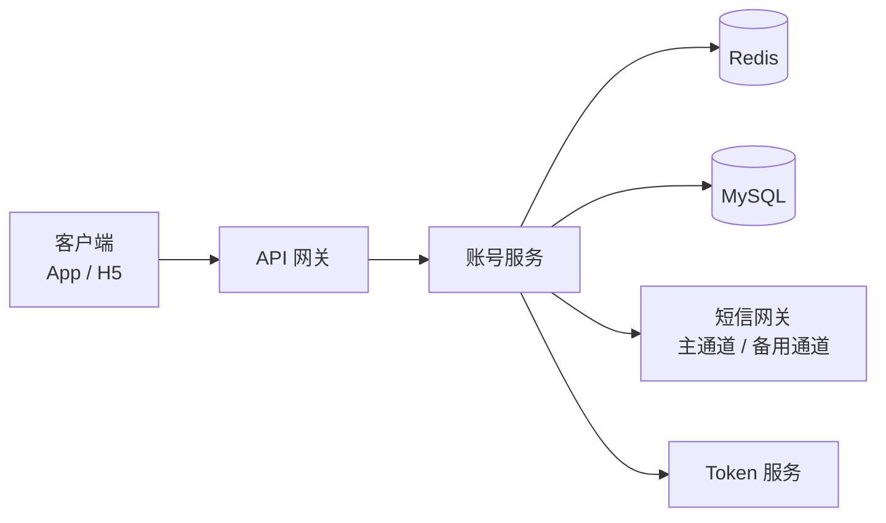
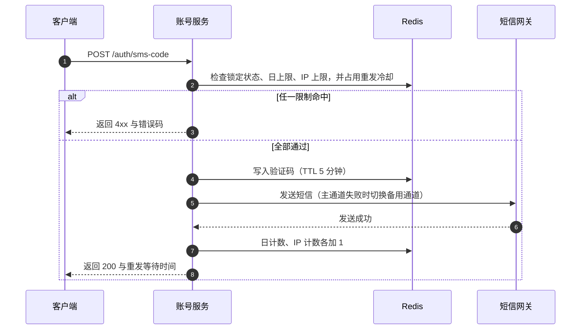
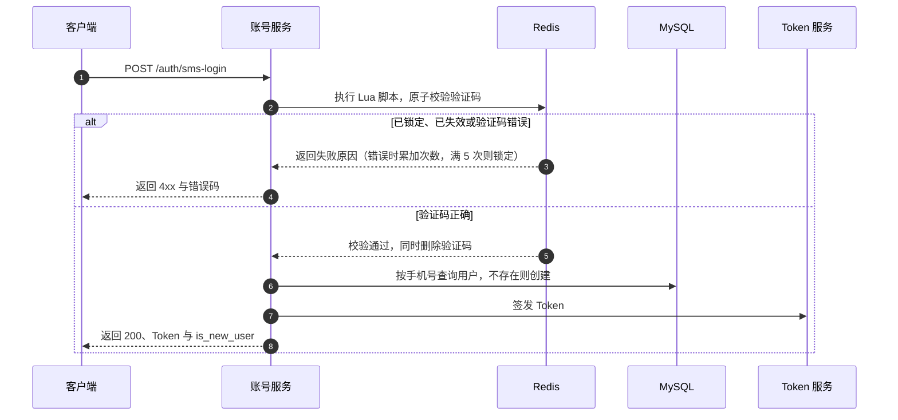

# 技术设计文档：手机号验证码登录

> 说明：本文为示例文档，所涉功能、数据与人员均为虚构，仅用于展示文档写法。

| 文档状态 | 版本 | 作者 | 评审人 | 对应需求 | 最后更新 |
|---|---|---|---|---|---|
| 已评审 | V1.0 | 李四 | 赵六（架构）· 钱七（安全）· 王五（测试） | [产品需求文档](01-prd.md) V1.1 | 2026-11-20 |

## 1. 概述

### 1.1 设计摘要

| 项目 | 内容 |
|---|---|
| 设计目标 | 在账号服务中实现手机号验证码登录与自动注册，满足 PRD 的 R1 至 R5 |
| 方案要点 | 新增“发送验证码”“验证码登录”两个接口；验证码、频控计数与锁定状态存储于 Redis；短信经主、备双通道发送；登录态复用现有 Token 服务 |
| 关键决策 | ① 状态存储选用 Redis<br/>② 短信采用同步发送<br/>③ 频率限制在账号服务内实现<br/>④ 以 Lua 脚本保证校验的原子性<br/>详见第 4 章 |
| 影响范围 | 仅账号服务；user 表新增 1 个字段、1 个唯一索引；不新增中间件；现有密码登录不受影响 |
| 主要风险 | 短信接口被恶意调用；存量重复手机号阻碍唯一索引的创建。详见第 8 章 |

### 1.2 阅读指引

| 读者 | 建议阅读章节 |
|---|---|
| 架构与安全评审 | 第 1 至 4 章、第 6 章 |
| 研发 | 第 3、5 章 |
| 测试 | 5.1 节（接口与错误码）、5.4 节（配置项）、6.2 节（容错） |
| 运维 | 第 6、7 章 |

## 2. 需求与约束

### 2.1 功能需求

| 需求 | 要点 | 设计章节 |
|---|---|---|
| R1 获取验证码 | 6 位验证码，5 分钟有效，60 秒内不可重发 | 5.3.1 |
| R2 验证码登录 | 验证码一次有效；输错 5 次锁定 15 分钟 | 5.3.2 |
| R3 新用户自动注册 | 未注册手机号验证通过后自动建号；一个手机号对应一个账号 | 5.3.3 |
| R4 防刷与频率限制 | 单手机号 10 条/日，单 IP 20 条/小时，在服务端强制执行 | 5.3.1 |
| R5 短信通道容灾 | 主通道失败时自动切换至备用通道 | 5.3.1、6.2 |
| R6 人机验证（P2） | 本期不实现，预留接入点 | 5.3.1 |

### 2.2 非功能需求

| 质量属性 | 指标 | 设计对应 |
|---|---|---|
| 性能 | 两个接口的 P99 低于 300ms，错误率低于 0.1% | 状态读写均走 Redis；登录校验仅需一次网络往返（D4） |
| 容量 | 峰值 100 QPS | 6.1 节 |
| 可用性 | 月度可用性不低于 99.9% | 短信主、备通道；依赖故障时快速失败（6.2 节） |
| 安全 | 验证码不泄露；防范短信轰炸与暴力破解 | 6.3 节 |
| 可回滚 | 分钟级回滚 | 功能开关（第 7 章） |

### 2.3 约束与假设

| 类别 | 内容 |
|---|---|
| 约束 | 复用现有 Redis Cluster 与 MySQL，不新增中间件 |
| 约束 | 开发周期为 7 个工作日，后端 1 人 |
| 约束 | 短信供应商提供同步 HTTP 接口，其 P99 耗时约 150ms（供应商 SLA 数据） |
| 假设 | 日均发码量约 15 万条，日常峰值约 20 QPS（依据现有登录流量估算） |
| 假设 | 仅支持中国大陆手机号 |

## 3. 总体设计

### 3.1 系统架构



| 组件 | 职责 | 本次改动 |
|---|---|---|
| API 网关 | 路由转发；写入客户端真实 IP（`X-Real-IP`） | 新增两条路由 |
| 账号服务 | 验证码的生成与校验、频率限制、自动注册 | 主要改动所在 |
| Redis | 存储验证码、频控计数、锁定状态 | 新增 5 类 Key |
| MySQL | 存储用户账号 | user 表新增字段与唯一索引 |
| 短信网关 | 封装主、备短信通道 | 新增备用通道及切换逻辑 |
| Token 服务 | 签发与校验登录凭证 | 无改动 |

### 3.2 发送验证码流程



### 3.3 验证码登录流程



## 4. 关键设计决策

### D1 验证码与频控状态的存储

| 评估维度 | Redis（采纳） | MySQL |
|---|---|---|
| 过期处理 | 原生 TTL，自动过期 | 须由定时任务清理 |
| 读写性能 | 内存读写，毫秒级 | 高频计数更新对主库形成压力 |
| 数据可靠性 | 故障时可能丢失 | 持久化 |
| 团队熟悉度 | 高，已有集群 | 高 |

**结论**：采纳 Redis。验证码属短时数据，丢失后用户可重新获取，无须持久化。
**代价**：Redis 成为验证码登录的强依赖，其故障处理见 6.2 节。

### D2 短信发送方式

| 评估维度 | 同步调用（采纳） | 消息队列异步发送 |
|---|---|---|
| 失败反馈 | 发送失败可即时告知用户 | 须借助额外机制通知用户 |
| 实现复杂度 | 低 | 中：须实现消费者、重试与死信处理 |
| 接口耗时 | 受短信通道耗时影响 | 稳定 |
| 容量上限 | 满足 100 QPS 的目标 | 可削峰，上限更高 |

**结论**：采纳同步调用。
**代价**：发码接口的耗时受短信通道影响。当峰值超过 500 QPS，或通道 P99 耗时超过 1 秒时，应改为异步发送（见 10.2 节）。

### D3 频率限制的实现位置

| 评估维度 | 账号服务内（采纳） | API 网关插件 |
|---|---|---|
| 规则表达能力 | 可按手机号、IP 等业务维度限流 | 仅支持 IP、路径等通用维度 |
| 维护成本 | 规则与业务代码同处，随需求迭代 | 变更须网关团队配合 |
| 资源消耗 | 超限请求仍会到达服务 | 超限请求在网关即被拦截 |

**结论**：采纳服务内实现。R4-1 须按手机号限流，网关无法表达。
**代价**：恶意流量仍会到达账号服务；网关现有的全局限流继续作为第一道防线。

### D4 验证码校验的并发安全

| 评估维度 | Lua 脚本（采纳） | 分布式锁 |
|---|---|---|
| 原子性 | 脚本在 Redis 内原子执行 | 依赖锁的正确获取与释放 |
| 网络往返 | 1 次 | 至少 3 次（加锁、操作、解锁） |
| 故障模式 | 不存在锁残留 | 须处理锁超时与误释放 |
| 可维护性 | 逻辑位于脚本内，须单独调试与测试 | 逻辑位于业务代码内，可用常规手段调试 |

**结论**：采纳 Lua 脚本，将“比对、计数、删除”合并为一次原子操作，避免同一验证码被并发使用两次。
**代价**：脚本须单独维护与测试；Redis Cluster 下相关 Key 须位于同一槽位（见 5.2.1 节）。

## 5. 详细设计

### 5.1 接口设计

| 接口 | 方法与路径 | 对应需求 |
|---|---|---|
| 发送验证码 | `POST /api/v1/auth/sms-code` | R1、R4、R5 |
| 验证码登录 | `POST /api/v1/auth/sms-login` | R2、R3 |

**发送验证码**

```jsonc
// 请求
{ "phone": "13800000000" }

// 响应
{ "code": 0, "message": "ok", "data": { "resend_after": 60 } }
```

**验证码登录**

```jsonc
// 请求
{ "phone": "13800000000", "code": "123456" }

// 响应
{
  "code": 0,
  "message": "ok",
  "data": {
    "access_token": "eyJ...",
    "refresh_token": "eyJ...",
    "expires_in": 7200,
    "is_new_user": false
  }
}
```

**错误码**（面向用户的提示文案见 PRD 6.8 节）

| 错误码 | HTTP 状态码 | 含义 | 对应验收标准 |
|---|---|---|---|
| 40001 | 400 | 手机号格式错误 | R1-2 |
| 40101 | 401 | 验证码错误 | R2-2 |
| 40102 | 401 | 验证码已失效（过期、已使用或未获取） | R1-4、R2-3 |
| 40300 | 403 | 功能未开放（开关关闭或未命中灰度） | — |
| 42301 | 423 | 手机号已锁定 | R2-4 |
| 42901 | 429 | 60 秒内重复发送 | R1-3 |
| 42902 | 429 | 手机号当日发送次数超限 | R4-1 |
| 42903 | 429 | IP 每小时发送次数超限 | R4-2 |
| 50000 | 500 | 服务内部错误 | — |
| 50301 | 503 | 短信发送失败（主、备通道均失败） | R5-2 |

### 5.2 数据模型

#### 5.2.1 Redis

| Key | 值 | TTL | 用途 |
|---|---|---|---|
| `sms:code:{phone}` | Hash：`hmac`（验证码的 HMAC-SHA256 值）、`fails`（已输错次数） | 300 秒 | 验证码 |
| `sms:cd:{phone}` | 1 | 60 秒 | 重发冷却 |
| `sms:day:{phone}:{yyyyMMdd}` | 计数 | 至当日 24:00 | 手机号日上限 |
| `sms:ip:{ip}:{yyyyMMddHH}` | 计数 | 3600 秒 | IP 小时上限（按自然小时统计） |
| `sms:lock:{phone}` | 1 | 900 秒 | 输错锁定 |

Redis Cluster 下，Key 中的手机号部分须使用 hash tag，以保证 Lua 脚本涉及的 Key 位于同一槽位。

#### 5.2.2 MySQL

```sql
ALTER TABLE user
  ADD COLUMN register_source VARCHAR(16) NOT NULL DEFAULT 'password'
      COMMENT '注册来源：password / sms',
  ADD UNIQUE KEY uk_phone (phone);
```

- 未绑定手机号的存量账号，其 `phone` 为 NULL。唯一索引允许存在多个 NULL，此类账号不受影响。
- 线上现有 312 条重复手机号记录，须在创建索引前完成清洗（见第 8 章）。

### 5.3 核心逻辑

#### 5.3.1 发送验证码

按以下顺序执行：

| 步骤 | 处理 | 不通过时的返回 |
|---|---|---|
| 1 | 校验手机号格式 | 40001 |
| 2 | 检查锁定状态（`sms:lock`） | 42301 |
| 3 | 检查手机号日计数与 IP 小时计数 | 42902 / 42903 |
| 4 | 人机验证（R6 的预留扩展点，本期不校验） | — |
| 5 | 占用重发冷却：`SET sms:cd:{phone} 1 NX EX 60`。该操作同时作为同一手机号的并发互斥 | 42901 |
| 6 | 以密码学安全随机数生成 6 位验证码，写入 `sms:code`。写入会覆盖旧值，旧验证码随即失效 | — |
| 7 | 调用短信网关。主通道失败或超过 2 秒未响应时，切换至备用通道 | 主、备均失败时，删除 `sms:cd` 与 `sms:code`，返回 50301 |
| 8 | 手机号日计数、IP 小时计数各加 1 | — |

说明：

- 用于限流的 IP 取自网关写入的 `X-Real-IP`，不采信客户端传入的 `X-Forwarded-For`。
- IP 计数采用“先读后加”，高并发下实际发送量可能略高于 20 条。该限制用于粗粒度防刷，此误差可以接受。

#### 5.3.2 验证码校验

以下判断在同一个 Lua 脚本内原子完成：

| 步骤 | 判断条件 | 处理 |
|---|---|---|
| 1 | `sms:lock` 存在 | 返回 42301 |
| 2 | `sms:code` 不存在 | 返回 40102 |
| 3 | 验证码不匹配 | `fails` 加 1。达到 5 次时，删除 `sms:code`，写入 `sms:lock`，返回 42301；否则返回 40101 |
| 4 | 验证码匹配 | 删除 `sms:code`，校验通过 |

#### 5.3.3 自动注册

校验通过后按手机号查询用户。用户不存在时直接执行 `INSERT`，由唯一索引 `uk_phone` 保证一个手机号仅对应一个账号；发生唯一键冲突时，改为查询已有账号。默认昵称为“用户”加手机尾号 4 位。

### 5.4 配置项

PRD 中的全部数值均已配置化，测试环境可按需调小。

| 配置项 | 默认值 | 对应验收标准 |
|---|---|---|
| `sms_login.enabled` | false | 功能总开关，用于灰度与回滚 |
| `sms_login.gray_percent` | 0 | 灰度比例 |
| `sms.code_ttl_seconds` | 300 | R1-4 |
| `sms.resend_interval_seconds` | 60 | R1-3 |
| `sms.max_fails` | 5 | R2-4 |
| `sms.lock_seconds` | 900 | R2-4 |
| `sms.daily_limit_per_phone` | 10 | R4-1 |
| `sms.hourly_limit_per_ip` | 20 | R4-2 |

## 6. 非功能设计

### 6.1 容量评估

| 项目 | 评估结果 |
|---|---|
| 请求量 | 日均发码约 15 万次；日常峰值约 20 QPS；设计容量 100 QPS，约为日常峰值的 5 倍 |
| 账号服务 | 现有 8 个实例，单实例容量约 500 QPS，无须扩容 |
| Redis | 峰值时并存的 Key 约 25 万个，占用内存约 50 MB，现有集群无须扩容 |
| MySQL | 仅新增唯一索引；写入量等于新用户注册量，峰值低于 10 QPS |
| 短信费用 | 15 万条/日 × 0.045 元 ≈ 6,750 元/日，约 20 万元/月 |

### 6.2 可用性与容错

| 故障场景 | 系统行为 | 用户影响 | 恢复方式 |
|---|---|---|---|
| 短信主通道失败或超时 | 2 秒超时后自动切换至备用通道 | 无感知，短信至多延迟 2 秒 | 自动 |
| 短信主、备通道均失败 | 返回 50301；清除冷却与验证码，不计入发送次数 | 提示发送失败，可立即重试 | 通道恢复后自动恢复 |
| Redis 不可用 | 两个接口快速失败，不降级放行，以免频率限制被绕过 | 验证码登录不可用；登录页引导使用密码登录 | Redis 恢复后自动恢复 |
| MySQL 或 Token 服务不可用 | 验证码校验通过后的步骤失败，返回 50000；验证码已被消耗 | 须重新获取验证码。此时全站登录均不可用，该影响可以接受 | 依赖恢复后自动恢复 |

### 6.3 安全设计

| 威胁 | 防护措施 |
|---|---|
| 短信轰炸（针对单一手机号） | 60 秒重发冷却；单手机号每日上限 10 条 |
| 短信盗刷（批量手机号） | 单 IP 每小时上限 20 条；短信发送量告警；预留人机验证扩展点 |
| 伪造 IP 绕过限流 | IP 取自网关写入的 `X-Real-IP`，不采信客户端请求头 |
| 验证码暴力破解 | 同一验证码输错 5 次即作废并锁定 15 分钟。单日至多 10 个验证码、每个 5 次尝试，命中概率不超过 0.005% |
| 验证码重放 | Lua 脚本原子校验并删除，验证码仅可使用一次 |
| 验证码泄露 | Redis 仅存储 HMAC 值，不存明文；日志不打印验证码，手机号脱敏后打印 |

### 6.4 监控与告警

| 监控指标 | 告警阈值 | 告警级别 |
|---|---|---|
| 短信发送成功率 | 5 分钟内低于 95% | P0，电话 |
| 接口 5xx 比例 | 5 分钟内高于 1% | P0，电话 |
| 接口 P99 | 5 分钟内高于 300ms | P1，群通知 |
| 限流命中次数 | 环比上涨 3 倍 | P1，群通知（可能遭遇恶意调用） |
| 短信日发送量 | 超过预算（15 万条/日）的 120% | P1，群通知 |

## 7. 发布与回滚

### 7.1 发布步骤

| 步骤 | 日期 | 操作 | 观察项 |
|---|---|---|---|
| 1 | 12-08 | 清洗重复手机号；在业务低峰期以 Online DDL 创建唯一索引 | DDL 执行无报错 |
| 2 | 12-09 | 发布代码，功能开关保持关闭 | 密码登录无异常 |
| 3 | 12-09 | 打开功能开关，灰度 5% | 短信发送成功率、登录成功率 |
| 4 | 12-10 | 灰度扩大至 30% | 同上，并关注短信消耗 |
| 5 | 12-14 | 全量发布 | 同上 |

### 7.2 回滚方案

| 项目 | 内容 |
|---|---|
| 触发条件 | 满足以下任意一项：<br/>① 短信发送成功率低于 90% 且持续 10 分钟<br/>② 接口 5xx 比例高于 5% 且持续 5 分钟<br/>③ 发现频率限制失效或其他安全问题 |
| 回滚操作 | 将 `sms_login.enabled` 置为 false，1 分钟内生效，登录页恢复为仅密码登录 |
| 数据处理 | 无须回滚数据，已创建的账号保留 |
| 回滚影响 | 仅通过验证码注册的用户尚未设置密码，回滚期间无法登录。因此回滚后须优先修复并重新开放 |

## 8. 风险与应对

| 风险 | 可能性 | 影响 | 应对措施 |
|---|---|---|---|
| 短信接口被恶意调用，产生费用损失 | 高 | 高 | 频率限制；短信日发送量告警；预留人机验证扩展点 |
| 存量 312 条重复手机号导致唯一索引创建失败 | 确定 | 中 | 发布前清洗数据：保留最近活跃账号的手机号，其余账号的手机号置空，并将名单同步客服 |
| 发码接口耗时因短信通道波动而超标 | 中 | 中 | 通道超时设为 2 秒；监控接口 P99；持续超标时按 D2 改为异步发送 |
| 回滚期间，仅通过验证码注册的用户无法登录 | 低 | 中 | 逐步放量以降低回滚概率；回滚后优先修复 |

## 9. 工作量与排期

后端 1 人，11-23 至 12-01，共 7 个工作日。

| 任务 | 工作量（人日） |
|---|---|
| 发送验证码接口（含重发冷却、频率限制） | 2 |
| 验证码登录接口（含 Lua 校验、锁定、自动注册） | 2 |
| 短信主、备通道切换 | 1 |
| 重复手机号清洗脚本与唯一索引 | 0.5 |
| 功能开关、监控与告警 | 0.5 |
| 联调与自测 | 1 |
| **合计** | **7** |

## 10. 待决事项与后续演进

### 10.1 待决事项

| 事项 | 负责人 | 截止时间 |
|---|---|---|
| 重复手机号的保留规则（保留最近活跃账号）须经客服团队确认 | 李四 | 11-27 |
| 备用短信通道的签名与模板审核 | 李四 | 11-25 |

### 10.2 后续演进

| 触发条件 | 演进方向 |
|---|---|
| 峰值超过 500 QPS，或短信通道 P99 耗时超过 1 秒 | 短信发送改为消息队列异步处理 |
| 灰度期限流命中率超过 1% | 在发码步骤 4 接入人机验证（PRD 的 R6） |
| 业务拓展至海外 | 手机号统一为 E.164 格式；频率限制按国家码区分 |
