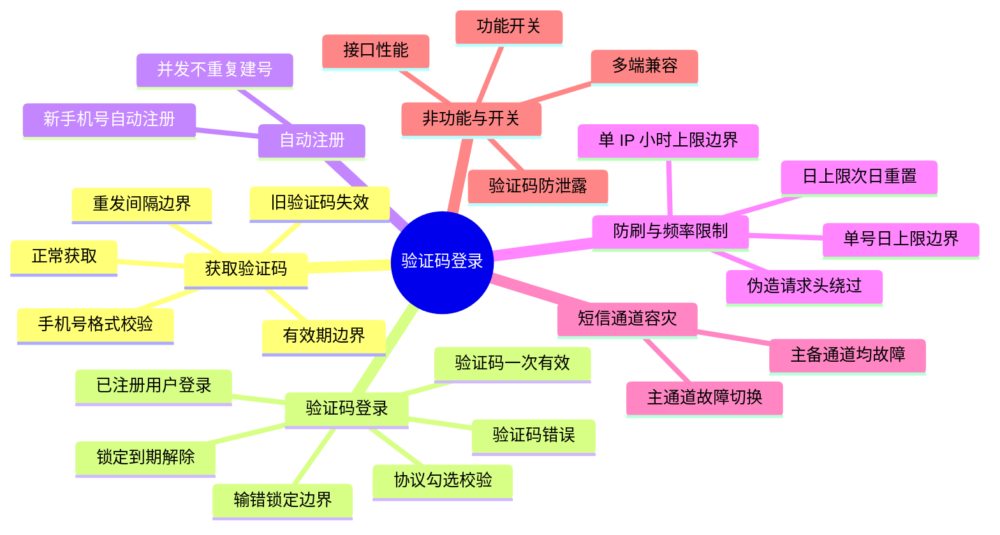

# 测试方案：手机号验证码登录

> 说明：本文为示例文档，所涉功能、数据与人员均为虚构，仅用于展示文档写法。

| 文档状态 | 版本 | 测试负责人 | 评审人 | 测试依据 | 最后更新 |
|---|---|---|---|---|---|
| 已评审 | V1.0 | 王五 | 张三（产品）· 李四（研发） | [产品需求文档](01-prd.md) V1.1 · [技术设计文档](02-tech-design.md) V1.0 | 2026-11-27 |

## 1. 概述

### 1.1 测试摘要

| 项目 | 内容 |
|---|---|
| 测试对象 | 手机号验证码登录：App 与 H5 的登录页、账号服务新增的两个接口 |
| 测试目标 | 验证 PRD 的 R1 至 R5 全部验收标准及非功能需求，给出能否上线的结论 |
| 测试重点 | 频率限制、输错锁定、并发场景下验证码的一次性。上述环节失效将直接造成费用损失或安全问题 |
| 用例规模 | 共 23 条：P0 13 条、P1 8 条、P2 2 条；其中 18 条实现接口自动化 |
| 周期与人力 | 2026-12-02 至 12-08，测试 1 人 |

### 1.2 阅读指引

| 读者 | 建议阅读章节 |
|---|---|
| 产品、项目经理 | 第 1、2、5、9 章 |
| 研发 | 第 3 章、第 5 章（准入标准）、第 7 章 |
| 测试 | 全文 |

## 2. 测试范围

| 类别 | 内容 | 说明 |
|---|---|---|
| 范围内 | PRD 的 R1 至 R5 全部验收标准 | 见第 6、7 章 |
| 范围内 | 非功能需求：安全、性能、兼容性 | 指标见 PRD 第 7 章 |
| 范围内 | 功能开关 | 开关是回滚手段，须验证其有效 |
| 范围外 | 密码登录、Token 服务 | 无改动，仅执行既有回归用例 |
| 范围外 | R6 人机验证 | 本期不实现 |
| 范围外 | 运营商侧的短信到达率、月度可用性 | 无法在测试环境验证，上线后通过监控评估 |

## 3. 测试策略

### 3.1 测试分层

| 层级 | 覆盖内容 | 执行方式 | 负责人 | 覆盖目标 |
|---|---|---|---|---|
| 单元测试 | 验证码的生成与校验、频率限制判断、Lua 脚本 | 自动化，随代码提交执行 | 研发 | 核心逻辑行覆盖率不低于 80% |
| 接口测试 | R1 至 R5 的业务规则（规则均在服务端实现） | 自动化，接入 CI | 测试 | 覆盖全部可自动化的验收标准，共 18 条用例 |
| 端到端测试 | 登录页主流程、页面交互、多端兼容 | 手工 | 测试 | 覆盖主流程及 6 款机型 |

### 3.2 测试类型

| 测试类型 | 测试内容 | 对应用例 |
|---|---|---|
| 功能测试 | R1 至 R5 的验收标准、功能开关 | TC-01 至 TC-19、TC-23 |
| 安全测试 | 验证码是否以明文出现在接口响应、日志、Redis 中 | TC-20 |
| 性能测试 | 发码接口与登录接口在 100 QPS 下持续 10 分钟 | TC-21 |
| 兼容性测试 | iOS、Android、H5 各 2 款主流机型 | TC-22 |
| 回归测试 | 登录模块的既有自动化用例（密码登录、退出、Token 刷新） | 既有 86 条 |

### 3.3 重点风险与测试设计

| 风险领域 | 失效后果 | 测试设计方法 | 对应用例 |
|---|---|---|---|
| 频率限制 | 短信轰炸、费用损失 | 边界值（第 N 次与第 N+1 次）；伪造请求头绕过 | TC-03、TC-14、TC-16、TC-17 |
| 输错锁定 | 验证码被暴力破解 | 边界值（第 4 次与第 5 次）；锁定期间及解除后的行为 | TC-09、TC-10 |
| 并发一致性 | 验证码被重复使用、重复创建账号 | 并发请求 | TC-13 |
| 依赖故障 | 用户无法登录 | 故障注入（模拟短信通道失败） | TC-18、TC-19 |

## 4. 测试环境与数据

| 项目 | 说明 |
|---|---|
| 测试环境 | 短信使用 Mock 通道，验证码通过 Mock 查询接口获取；支持模拟主、备通道故障 |
| 预发环境 | 使用真实短信通道与白名单手机号，主、备通道各验证 1 次 |
| 时间相关用例 | 测试环境通过配置项缩短有效期、重发间隔与锁定时长后执行自动化；预发环境以真实参数各执行 1 次 |
| 测试数据 | 已注册手机号 5 个；未注册号段 1 个（自动化专用），执行结束后清理账号与 Redis 数据 |

## 5. 准入与准出标准

| 阶段 | 标准 |
|---|---|
| 准入（提测） | ① 单元测试全部通过，核心逻辑行覆盖率不低于 80% ② 研发自测通过冒烟用例 TC-01、TC-06、TC-12 ③ 测试环境部署完成，Mock 短信通道可用 |
| 准出（上线） | ① P0、P1 用例通过率 100% ② P0、P1 缺陷全部关闭；P2 遗留缺陷不超过 3 个，且经产品确认 ③ 性能达到 PRD 第 7 章的指标 ④ 接口自动化用例接入 CI 且全部通过 |

## 6. 测试设计

### 6.1 测试点

### 6.2 需求覆盖矩阵

PRD 的 18 条验收标准均有用例覆盖。

| 需求 | 验收标准数 | 对应用例 | 用例数 |
|---|---|---|---|
| R1 获取验证码 | 5 | TC-01 至 TC-05 | 5 |
| R2 验证码登录 | 5 | TC-06 至 TC-11 | 6 |
| R3 新用户自动注册 | 3 | TC-12、TC-13 | 2 |
| R4 防刷与频率限制 | 3 | TC-14 至 TC-17 | 4 |
| R5 短信通道容灾 | 2 | TC-18、TC-19 | 2 |
| 非功能需求与功能开关 | — | TC-20 至 TC-23 | 4 |
| **合计** | **18** | — | **23** |

## 7. 测试用例

说明：

- “关联需求”为 PRD 的验收标准编号。
- “预期结果”中的五位数字为技术设计文档 5.1 节定义的错误码。
- “自动化”为“是”的用例已实现接口自动化并接入 CI。

### 7.1 获取验证码

| 编号 | 关联需求 | 优先级 | 用例标题 | 前置条件 | 测试步骤 | 预期结果 | 自动化 |
|---|---|---|---|---|---|---|---|
| TC-01 | R1-1 | P0 | 正常获取验证码 | 手机号合法，未触发任何限制 | 输入手机号，点击“获取验证码” | 收到 6 位数字验证码；按钮进入 60 秒倒计时 | 是 |
| TC-02 | R1-2 | P0 | 手机号格式校验 | — | 依次输入 10 位、12 位、含字母、首位为 2、第 2 位为 2 的号码 | 按钮置灰；直接请求接口返回 40001，不发送短信 | 是 |
| TC-03 | R1-3 | P0 | 重发间隔边界 | 验证码已发送成功 | 分别在第 59 秒、第 61 秒再次请求 | 第 59 秒返回 42901，不发送短信；第 61 秒发送成功 | 是 |
| TC-04 | R1-4 | P1 | 有效期边界 | 验证码已发送成功 | 分别在第 4 分 59 秒、第 5 分 01 秒使用正确验证码登录（两次独立执行） | 前者登录成功；后者返回 40102 | 是 |
| TC-05 | R1-5 | P1 | 旧验证码失效 | 已获取验证码 A，并在 61 秒后获取验证码 B | 先使用 A 登录，再使用 B 登录 | A 返回 40101；B 登录成功 | 是 |

### 7.2 验证码登录

| 编号 | 关联需求 | 优先级 | 用例标题 | 前置条件 | 测试步骤 | 预期结果 | 自动化 |
|---|---|---|---|---|---|---|---|
| TC-06 | R2-1 | P0 | 已注册用户登录 | 手机号已注册，已获取验证码 | 输入正确验证码，点击“登录” | 登录成功；`is_new_user=false`；未新建账号 | 是 |
| TC-07 | R2-2 | P0 | 验证码错误 | 已获取验证码 | 输入错误的验证码，点击“登录” | 返回 40101；验证码输入框清空，停留在登录页 | 是 |
| TC-08 | R2-3 | P0 | 验证码一次有效 | 已使用某验证码登录成功并退出 | 使用同一验证码再次登录 | 返回 40102 | 是 |
| TC-09 | R2-4 | P0 | 输错锁定边界 | 已获取验证码 | ① 输错 4 次后输入正确验证码 ② 更换手机号，输错 5 次后输入正确验证码，再请求获取验证码 | ① 登录成功 ② 第 5 次输错返回 42301；其后的登录请求与获取验证码请求均返回 42301 | 是 |
| TC-10 | R2-4 | P1 | 锁定到期解除 | 手机号已被锁定满 15 分钟 | 重新获取验证码并登录 | 登录成功 | 是 |
| TC-11 | R2-5 | P0 | 协议勾选校验 | 进入登录页，未做任何操作 | 不勾选协议，点击“登录” | 协议默认未勾选；提示先同意协议；未发起登录请求 | 否 |

### 7.3 新用户自动注册

| 编号 | 关联需求 | 优先级 | 用例标题 | 前置条件 | 测试步骤 | 预期结果 | 自动化 |
|---|---|---|---|---|---|---|---|
| TC-12 | R3-1、R3-2 | P0 | 新手机号自动注册 | 手机号未注册，已获取验证码 | 输入正确验证码，点击“登录” | 登录成功；`is_new_user=true`；新建 1 个账号，昵称为“用户”+ 手机尾号 4 位 | 是 |
| TC-13 | R3-3 | P1 | 并发登录不重复建号 | 手机号未注册，已获取验证码 | 使用正确验证码并发发起 10 个登录请求 | 仅 1 个请求成功；user 表中该手机号仅有 1 条记录 | 是 |

### 7.4 防刷与频率限制

| 编号 | 关联需求 | 优先级 | 用例标题 | 前置条件 | 测试步骤 | 预期结果 | 自动化 |
|---|---|---|---|---|---|---|---|
| TC-14 | R4-1 | P0 | 单号日上限边界 | 同一手机号当日已成功发送 9 条 | 间隔 60 秒以上，发起第 10 次、第 11 次获取 | 第 10 次成功；第 11 次返回 42902 | 是 |
| TC-15 | R4-1 | P2 | 日上限次日重置 | 手机号当日已达发送上限 | 次日 0 点后再次获取 | 发送成功 | 否 |
| TC-16 | R4-2 | P1 | 单 IP 小时上限边界 | 同一 IP 在当前小时内已成功发送 19 条 | 更换手机号，发起第 20 次、第 21 次获取 | 第 20 次成功；第 21 次返回 42903 | 是 |
| TC-17 | R4-3 | P0 | 伪造请求头绕过限流 | 同一 IP 在当前小时内已成功发送 20 条 | 以脚本直接请求发码接口，并伪造 `X-Forwarded-For` 更换 IP | 伪造无效，仍返回 42903 | 是 |

### 7.5 短信通道容灾

| 编号 | 关联需求 | 优先级 | 用例标题 | 前置条件 | 测试步骤 | 预期结果 | 自动化 |
|---|---|---|---|---|---|---|---|
| TC-18 | R5-1 | P1 | 主通道故障切换 | 模拟主通道返回失败 | 获取验证码 | 经备用通道发送成功，收到验证码；接口返回成功 | 是 |
| TC-19 | R5-2 | P1 | 主备通道均故障 | 模拟主、备通道均返回失败 | 获取验证码；恢复通道后立即再次获取 | 首次返回 50301，按钮不进入倒计时；恢复后立即获取成功；当日发送次数仅计 1 次 | 是 |

### 7.6 非功能与功能开关

| 编号 | 关联需求 | 优先级 | 用例标题 | 前置条件 | 测试步骤 | 预期结果 | 自动化 |
|---|---|---|---|---|---|---|---|
| TC-20 | 安全 | P0 | 验证码防泄露 | 已发送验证码 | 检查接口响应、服务日志、Redis | 三处均无明文验证码；日志中的手机号已脱敏 | 否 |
| TC-21 | 性能 | P1 | 接口性能 | 短信通道使用 Mock（模拟 50ms 延迟） | 对发码接口与登录接口分别施加 100 QPS 压力，持续 10 分钟 | P99 低于 300ms；错误率低于 0.1% | 否 |
| TC-22 | 兼容性 | P2 | 多端主流程 | iOS、Android、H5 各 2 款机型 | 执行“获取验证码 → 自动填充 → 登录” | 流程正常，验证码可自动填充 | 否 |
| TC-23 | 功能开关 | P0 | 关闭开关后的回滚效果 | `sms_login.enabled` 置为 false | 打开登录页；直接请求两个新增接口 | 登录页仅展示密码登录；接口返回 40300；密码登录正常 | 是 |

## 8. 风险与应对

| 风险 | 影响 | 应对措施 |
|---|---|---|
| 测试环境无法验证真实短信的到达情况 | 通道接入问题可能遗漏 | 预发环境使用白名单手机号，主、备通道各验证 1 次；灰度期监控短信发送成功率 |
| 时间相关用例在测试环境使用缩短后的参数 | 真实参数下的行为未被自动化覆盖 | 预发环境以真实参数各执行 1 次 |
| 兼容性测试仅覆盖 6 款机型 | 个别机型的问题可能遗漏 | 灰度期按机型监控“获取验证码至登录成功”的转化率 |
| 频率限制用例会耗尽测试 IP 与手机号的配额 | 影响其他测试活动 | 自动化使用专用号段；执行结束后清理 Redis 数据 |

## 9. 进度计划

| 日期 | 工作内容 | 产出 |
|---|---|---|
| 12-02 | 冒烟测试；接口自动化首轮执行 | 提测结论 |
| 12-02 至 12-04 | 功能测试，执行全部用例 | 缺陷清单 |
| 12-07 | 性能、安全、兼容性测试；预发环境验证真实短信 | 性能测试数据 |
| 12-08 | 缺陷回归；P0 用例全量回归 | 测试报告 |
