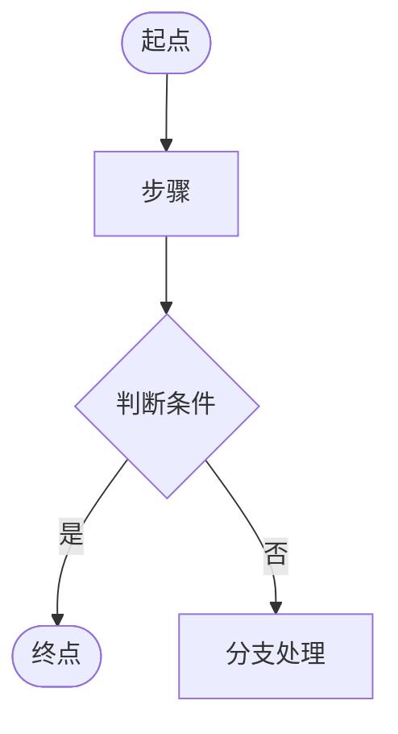

# 产品需求文档：{{功能名称}}

| 文档状态 | 版本 | 产品负责人 | 研发负责人 | 测试负责人 | 计划上线 | 最后更新 |
|---|---|---|---|---|---|---|
| {{草稿 / 评审中 / 已评审}} | {{V1.0}} | {{姓名}} | {{姓名}} | {{姓名}} | {{YYYY-MM-DD}} | {{YYYY-MM-DD}} |

相关文档：{{技术设计文档、测试方案、交互设计稿的链接；尚未产出的不列}}

## 1. 概述

### 1.1 需求摘要

| 项目 | 内容 |
|---|---|
| 需求背景 | {{一至两句，写出当前的问题及关键数据}} |
| 解决方案 | {{一至两句，写出本需求做什么}} |
| 预期收益 | {{带数字的结果，与 3.1 节一致}} |
| 需求范围 | {{涉及哪些端和系统；一句话说明不涉及什么}} |
| 上线计划 | {{灰度日期与全量日期}} |

### 1.2 阅读指引

| 读者 | 建议阅读章节 |
|---|---|
| 管理者、项目经理 | {{章节}} |
| 研发、测试 | {{章节}} |
| 设计、运营、客服 | {{章节}} |

文中的专业术语见附录 A。

## 2. 背景与问题

{{两三句话描述现状：当前是怎样的，谁受到影响}}

| 问题 | 数据依据（{{统计时间}}） | 业务影响 |
|---|---|---|
| {{问题}} | {{数据及其来源}} | {{对用户或业务的影响}} |

{{一句话说明不解决的后果}}

## 3. 目标与范围

### 3.1 目标与成功指标

| 编号 | 目标 | 衡量指标 | 基线 | 目标值 | 指标类型 | 评估时间 |
|---|---|---|---|---|---|---|
| G1 | {{要达到的结果}}（{{用户目标 / 业务目标}}） | {{指标名称}} | {{当前值}} | {{目标值}} | {{先行指标 / 滞后指标 / 护栏指标}} | {{何时评估}} |

指标口径：

- {{指标名称}} = {{计算公式或数据来源}}

### 3.2 非目标

| 非目标 | 原因 |
|---|---|
| {{本期不做的相邻事项}} | {{为什么不做}} |

## 4. 用户故事

| 编号 | 用户角色 | 用户故事 | 对应需求 |
|---|---|---|---|
| US-1 | {{具体的角色}} | 我希望{{想达成的事}}，以便{{得到的好处}} | {{需求编号}} |

## 5. 业务流程

{{将下图替换为本需求的主流程与关键分支}}

## 6. 功能需求

### 6.1 需求总览

| 编号 | 需求名称 | 优先级 | 对应用户故事 | 备注 |
|---|---|---|---|---|
| R1 | {{需求名称}} | {{P0 / P1 / P2}} | {{用户故事编号}} | {{没有则写“—”}} |

优先级定义：P0 为必须具备，缺失则不可上线；P1 为应当具备，时间不足时可延后；P2 为后续规划，本期不实现，但设计须兼容。

每条验收标准具有唯一编号，技术设计文档与测试用例均按编号引用。

### 6.2 R1 {{需求名称}}（{{优先级}}）

**需求描述**：{{一至两句，说明用户可以做什么，系统有什么限制}}

**验收标准**

| 编号 | 前置条件 | 操作 | 预期结果 |
|---|---|---|---|
| R1-1 | {{执行前的状态}} | {{用户或系统的动作}} | {{可判定的结果：数值、文案或状态}} |

{{其余需求按 6.2 节的结构各写一节，依次编号为 6.3、6.4……；P2 需求只写一段说明，不写验收标准}}

### 6.{{末节序号}} 异常提示文案

| 场景 | 提示文案 |
|---|---|
| {{异常场景}} | {{用户看到的完整文案}} |

## 7. 非功能需求

| 类别 | 要求 |
|---|---|
| 性能 | {{可测量的指标}} |
| 容量 | {{可测量的指标}} |
| 可用性 | {{可测量的指标}} |
| 安全与隐私 | {{具体要求}} |
| 兼容性 | {{系统版本、浏览器、机型范围}} |

## 8. 数据埋点

转化漏斗：{{步骤 1}} → {{步骤 2}} → {{步骤 3}}。

| 事件 | 触发时机 | 参数 |
|---|---|---|
| `{{event_name}}` | {{何时上报}} | {{参数及含义}} |

## 9. 里程碑、依赖与风险

### 9.1 里程碑

| 里程碑 | 日期 | 负责人 |
|---|---|---|
| 需求评审 | {{日期}} | {{姓名}} |
| 技术设计评审 | {{日期}} | {{姓名}} |
| 开发与自测 | {{起止日期}} | {{姓名}} |
| 测试 | {{起止日期}} | {{姓名}} |
| 灰度发布 | {{起止日期}} | {{姓名}} |
| 全量发布 | {{日期}} | {{姓名}} |

### 9.2 外部依赖

| 依赖事项 | 责任方 | 最晚完成时间 | 状态 |
|---|---|---|---|
| {{依赖的事项}} | {{团队或对接人}} | {{日期}} | {{未开始 / 进行中 / 已完成}} |

### 9.3 风险

| 风险 | 可能性 | 影响 | 应对措施 |
|---|---|---|---|
| {{可能发生的问题及其后果}} | {{高 / 中 / 低}} | {{高 / 中 / 低}} | {{具体措施}} |

## 10. 待决事项

| 编号 | 问题 | 负责角色 | 是否阻塞开发 | 期望结论时间 |
|---|---|---|---|---|
| Q1 | {{尚无结论的问题}} | {{谁来回答}} | {{是 / 否}} | {{日期}} |

## 附录 A 术语表

| 术语 | 说明 |
|---|---|
| {{术语或缩写}} | {{一句话解释}} |

## 附录 B 变更记录

| 版本 | 日期 | 变更内容 | 变更原因 | 修改人 |
|---|---|---|---|---|
| {{V1.0}} | {{日期}} | 初稿 | — | {{姓名}} |
