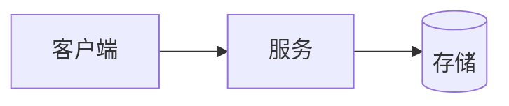
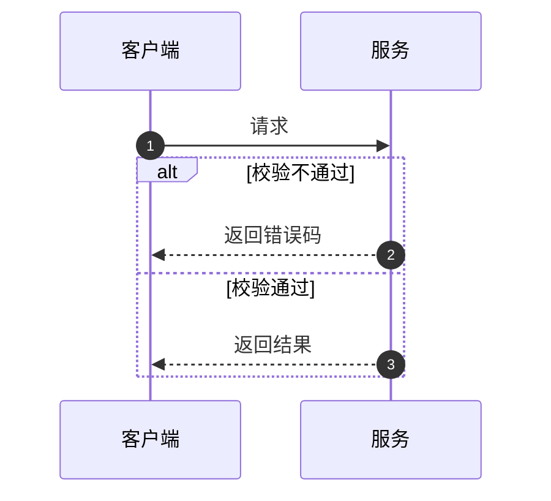

# 技术设计文档：{{功能名称}}

| 文档状态 | 版本 | 作者 | 评审人 | 对应需求 | 最后更新 |
|---|---|---|---|---|---|
| {{草稿 / 评审中 / 已评审}} | {{V1.0}} | {{姓名}} | {{姓名（角色）}} | {{产品需求文档的链接与版本}} | {{YYYY-MM-DD}} |

## 1. 概述

### 1.1 设计摘要

| 项目 | 内容 |
|---|---|
| 设计目标 | {{一句话：在哪个系统中实现什么，满足哪些需求}} |
| 方案要点 | {{三至四个要点：新增或修改什么，数据存在哪里，复用什么}} |
| 关键决策 | {{逐条列出第 4 章各决策的结论}} |
| 影响范围 | {{改动哪些服务、表、配置；是否新增组件；对现有功能有无影响}} |
| 主要风险 | {{最重要的一至两个风险，详见第 8 章}} |

### 1.2 阅读指引

| 读者 | 建议阅读章节 |
|---|---|
| 架构与安全评审 | {{章节}} |
| 研发 | {{章节}} |
| 测试 | {{章节}} |
| 运维 | {{章节}} |

## 2. 需求与约束

### 2.1 功能需求

| 需求 | 要点 | 设计章节 |
|---|---|---|
| {{需求编号与名称}} | {{一句话要点}} | {{实现该需求的章节号}} |

### 2.2 非功能需求

| 质量属性 | 指标 | 设计对应 |
|---|---|---|
| 性能 | {{指标}} | {{对应的设计措施与章节}} |
| 容量 | {{指标}} | {{对应的设计措施与章节}} |
| 可用性 | {{指标}} | {{对应的设计措施与章节}} |
| 安全 | {{要求}} | {{对应的设计措施与章节}} |
| 可回滚 | {{要求}} | {{对应的设计措施与章节}} |

### 2.3 约束与假设

| 类别 | 内容 |
|---|---|
| 约束 | {{技术栈、人力、工期、合规等限制}} |
| 假设 | {{尚未证实的前提，并注明依据}} |

## 3. 总体设计

### 3.1 系统架构

{{将下图替换为与本次设计相关的组件及其调用关系}}



| 组件 | 职责 | 本次改动 |
|---|---|---|
| {{组件名称}} | {{该组件负责什么}} | {{改了什么；没有则写“无改动”}} |

### 3.2 {{核心流程名称}}

{{将下图替换为该流程的时序图，包含主要的失败分支；其余核心流程各写一节，依次编号为 3.3、3.4……}}



## 4. 关键设计决策

### D1 {{决策主题}}

| 评估维度 | {{方案 A}}（采纳） | {{方案 B}} |
|---|---|---|
| {{对结论有区分作用的维度}} | {{方案 A 的表现}} | {{方案 B 的表现}} |

**结论**：{{采纳哪个方案，以及最主要的理由}}
**代价**：{{采纳方案的缺点及应对方式；达到什么条件时应重新评估}}

{{其余决策按 D1 的结构继续，依次编号为 D2、D3……}}

## 5. 详细设计

### 5.1 接口设计

| 接口 | 方法与路径 | 对应需求 |
|---|---|---|
| {{接口名称}} | `{{METHOD /path}}` | {{需求编号}} |

**{{接口名称}}**

```jsonc
// 请求
{{请求示例}}

// 响应
{{响应示例}}
```

**错误码**（面向用户的提示文案见产品需求文档）

| 错误码 | HTTP 状态码 | 含义 | 对应验收标准 |
|---|---|---|---|
| {{错误码}} | {{状态码}} | {{含义}} | {{验收标准编号；没有则写“—”}} |

### 5.2 数据模型

{{缓存：用表格列出 Key、值、过期时间、用途}}

{{数据库：给出可直接执行的 DDL，并说明对存量数据的影响}}

### 5.3 核心逻辑

#### 5.3.1 {{逻辑名称}}

| 步骤 | 处理 | 不通过时的返回 |
|---|---|---|
| 1 | {{这一步做什么}} | {{错误码或处理方式；没有则写“—”}} |

{{其余核心逻辑各写一小节，依次编号为 5.3.2、5.3.3……}}

### 5.4 配置项

| 配置项 | 默认值 | 对应验收标准 |
|---|---|---|
| `{{config.key}}` | {{默认值}} | {{验收标准编号或用途}} |

## 6. 非功能设计

### 6.1 容量评估

| 项目 | 评估结果 |
|---|---|
| 请求量 | {{日均量、日常峰值、设计容量及其依据}} |
| {{各组件}} | {{资源占用的估算过程；是否需要扩容}} |
| 费用 | {{新增费用的计算过程；没有则写“无新增费用”}} |

### 6.2 可用性与容错

| 故障场景 | 系统行为 | 用户影响 | 恢复方式 |
|---|---|---|---|
| {{某个依赖不可用}} | {{系统如何处理}} | {{用户看到什么}} | {{自动或手动；如何恢复}} |

### 6.3 安全设计

| 威胁 | 防护措施 |
|---|---|
| {{可能的攻击或泄露方式}} | {{具体措施}} |

### 6.4 监控与告警

| 监控指标 | 告警阈值 | 告警级别 |
|---|---|---|
| {{指标}} | {{阈值与持续时间}} | {{级别与通知方式}} |

## 7. 发布与回滚

### 7.1 发布步骤

| 步骤 | 日期 | 操作 | 观察项 |
|---|---|---|---|
| 1 | {{日期}} | {{操作}} | {{确认什么之后进入下一步}} |

### 7.2 回滚方案

| 项目 | 内容 |
|---|---|
| 触发条件 | {{可观测的阈值，满足任意一项即回滚}} |
| 回滚操作 | {{具体操作及生效时间}} |
| 数据处理 | {{是否需要回滚数据；如何处理已产生的数据}} |
| 回滚影响 | {{回滚期间对用户的影响}} |

## 8. 风险与应对

| 风险 | 可能性 | 影响 | 应对措施 |
|---|---|---|---|
| {{可能发生的问题及其后果}} | {{高 / 中 / 低 / 确定}} | {{高 / 中 / 低}} | {{具体措施}} |

## 9. 工作量与排期

{{人力与起止日期}}

| 任务 | 工作量（人日） |
|---|---|
| {{任务}} | {{人日}} |
| **合计** | **{{合计人日}}** |

## 10. 待决事项与后续演进

### 10.1 待决事项

| 事项 | 负责人 | 截止时间 |
|---|---|---|
| {{尚无结论的事项}} | {{姓名}} | {{日期}} |

### 10.2 后续演进

| 触发条件 | 演进方向 |
|---|---|
| {{可观测的条件}} | {{届时应做的调整}} |
