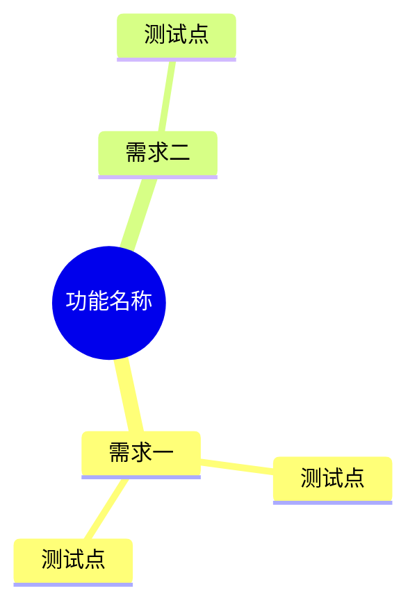

# 测试方案：{{功能名称}}

| 文档状态 | 版本 | 测试负责人 | 评审人 | 测试依据 | 最后更新 |
|---|---|---|---|---|---|
| {{草稿 / 评审中 / 已评审}} | {{V1.0}} | {{姓名}} | {{姓名（角色）}} | {{产品需求文档与技术设计文档的链接与版本}} | {{YYYY-MM-DD}} |

## 1. 概述

### 1.1 测试摘要

| 项目 | 内容 |
|---|---|
| 测试对象 | {{被测的功能、页面、接口}} |
| 测试目标 | {{验证哪些需求与指标，最终给出什么结论}} |
| 测试重点 | {{出错后果最严重的两三个环节，以及后果是什么}} |
| 用例规模 | {{用例总数；各优先级数量；自动化数量。与第 7 章一致}} |
| 周期与人力 | {{起止日期与人数}} |

### 1.2 阅读指引

| 读者 | 建议阅读章节 |
|---|---|
| 产品、项目经理 | {{章节}} |
| 研发 | {{章节}} |
| 测试 | 全文 |

## 2. 测试范围

| 类别 | 内容 | 说明 |
|---|---|---|
| 范围内 | {{要测的内容}} | {{对应的章节或指标来源}} |
| 范围外 | {{不测的内容}} | {{不测的原因}} |

## 3. 测试策略

### 3.1 测试分层

| 层级 | 覆盖内容 | 执行方式 | 负责人 | 覆盖目标 |
|---|---|---|---|---|
| 单元测试 | {{覆盖的逻辑}} | {{自动化 / 手工；何时执行}} | {{角色}} | {{可测量的目标}} |
| 接口测试 | {{覆盖的规则}} | {{执行方式}} | {{角色}} | {{可测量的目标}} |
| 端到端测试 | {{覆盖的流程}} | {{执行方式}} | {{角色}} | {{可测量的目标}} |

### 3.2 测试类型

| 测试类型 | 测试内容 | 对应用例 |
|---|---|---|
| 功能测试 | {{内容}} | {{用例编号范围}} |
| 安全测试 | {{内容}} | {{用例编号}} |
| 性能测试 | {{压力大小与持续时间}} | {{用例编号}} |
| 兼容性测试 | {{机型、系统、浏览器范围}} | {{用例编号}} |
| 回归测试 | {{既有用例的范围}} | {{既有用例数量}} |

### 3.3 重点风险与测试设计

| 风险领域 | 失效后果 | 测试设计方法 | 对应用例 |
|---|---|---|---|
| {{出错后果严重的环节}} | {{具体后果}} | {{边界值 / 并发 / 故障注入等，并写明如何设计}} | {{用例编号}} |

## 4. 测试环境与数据

| 项目 | 说明 |
|---|---|
| 测试环境 | {{环境的用途、模拟手段与限制}} |
| 预发环境 | {{用于验证测试环境无法覆盖的内容}} |
| 测试数据 | {{数据如何准备，执行后如何清理}} |

## 5. 准入与准出标准

| 阶段 | 标准 |
|---|---|
| 准入（提测） | {{可判定的条件，逐条编号}} |
| 准出（上线） | {{可判定的条件，逐条编号}} |

## 6. 测试设计

### 6.1 测试点

{{将下图替换为本次的测试点，按需求分组}}

### 6.2 需求覆盖矩阵

{{一句话说明验收标准的总数及覆盖情况}}

| 需求 | 验收标准数 | 对应用例 | 用例数 |
|---|---|---|---|
| {{需求编号与名称}} | {{数量}} | {{用例编号范围}} | {{数量}} |
| **合计** | **{{合计}}** | — | **{{合计}}** |

## 7. 测试用例

说明：

- “关联需求”为产品需求文档的验收标准编号。
- “预期结果”中的错误码定义见技术设计文档。
- “自动化”为“是”的用例已实现自动化并接入 CI。

### 7.1 {{需求名称}}

| 编号 | 关联需求 | 优先级 | 用例标题 | 前置条件 | 测试步骤 | 预期结果 | 自动化 |
|---|---|---|---|---|---|---|---|
| TC-01 | {{验收标准编号}} | {{P0 / P1 / P2}} | {{验证的行为}} | {{执行前的状态；没有则写“—”}} | {{可直接执行的操作}} | {{可判定的结果}} | {{是 / 否}} |

{{其余需求各写一节，依次编号为 7.2、7.3……；用例编号全文连续}}

## 8. 风险与应对

| 风险 | 影响 | 应对措施 |
|---|---|---|
| {{测不到或测不全的内容}} | {{可能遗漏什么}} | {{如何弥补}} |

## 9. 进度计划

| 日期 | 工作内容 | 产出 |
|---|---|---|
| {{日期}} | {{当天的测试活动}} | {{产出物}} |
