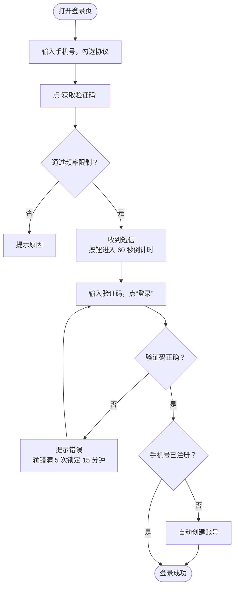

# PRD：手机号验证码登录

> 示例文档。功能、数据、人名均为虚构，只用来展示写法。

| 状态 | 产品 | 研发 | 测试 | 目标上线 | 最后更新 |
|---|---|---|---|---|---|
| 已评审 | 张三 | 李四 | 王五 | 2026-12-14 全量 | 2026-11-18 |

关联文档：[技术方案](02-tech-design.md) · [测试方案](03-test-plan.md) · 交互稿（Figma 链接）

## 1. 一句话

用户用**手机号 + 短信验证码**就能登录；没注册过的手机号自动注册。全程不需要密码。

## 2. 为什么做

| 问题 | 数据 |
|---|---|
| 登录流失高 | 登录页到登录成功的转化率只有 62%；流失用户中 41% 停在“忘记密码” |
| 客服成本高 | 密码重置工单 1,800 单/月，占全部工单的 15% |
| 注册门槛高 | 注册要填 4 项信息，完成率 48% |

## 3. 目标

| 指标 | 现状 | 目标 | 口径 |
|---|---|---|---|
| 登录转化率 | 62% | ≥ 75% | 登录成功 UV ÷ 登录页曝光 UV |
| 密码重置工单 | 1,800 单/月 | ≤ 900 单/月 | 客服系统“密码”类工单数 |
| 短信消耗（护栏指标） | — | ≤ 1.3 条/次成功登录 | 短信发送量 ÷ 登录成功次数 |

| 不做 | 原因 |
|---|---|
| 第三方登录（微信、Apple） | 下期做 |
| 海外手机号 | 当前没有海外业务 |
| 下线密码登录 | 保留，作为次要入口 |

## 4. 用户场景

| 用户 | 场景 | 期望 |
|---|---|---|
| 老用户 | 换了手机，忘了密码 | 输手机号、收验证码，直接登录 |
| 新用户 | 第一次打开 App | 不填表单，一步完成注册并登录 |
| 黑产 | 用脚本批量触发短信（短信轰炸） | 必须被拦住，见 R4 |

## 5. 主流程

## 6. 功能规格

每条规则有唯一编号。技术方案和测试用例都按编号引用，改规则时只改这里。

### R1 获取验证码（P0）

| 编号 | 规则 |
|---|---|
| R1-1 | 输入合法手机号，点“获取验证码”，下发 6 位数字验证码短信 |
| R1-2 | 手机号必须是 11 位大陆手机号（1 开头，第 2 位为 3–9）；不合法时按钮置灰 |
| R1-3 | 发送成功后按钮进入 60 秒倒计时，倒计时内不能重发 |
| R1-4 | 验证码 5 分钟内有效 |
| R1-5 | 重新获取后，旧验证码立即失效 |

“获取验证码”按钮的四种状态：

| 条件 | 按钮文字 | 能否点击 |
|---|---|---|
| 手机号未填或不合法 | 获取验证码（置灰） | 否 |
| 手机号合法 | 获取验证码 | 能 |
| 发送后 60 秒内 | 59s 后重新获取（逐秒递减） | 否 |
| 倒计时结束 | 重新获取 | 能 |

### R2 验证码登录（P0）

| 编号 | 规则 |
|---|---|
| R2-1 | 手机号 + 正确验证码 → 登录成功，回到登录前的页面；没有来源页则进首页 |
| R2-2 | 验证码错误 → 提示错误，清空验证码输入框，停留在当前页 |
| R2-3 | 验证码成功使用一次后立即失效 |
| R2-4 | 同一个验证码输错满 5 次 → 验证码作废，该手机号锁定 15 分钟。锁定期间不能用验证码登录，也不能获取验证码；密码登录不受影响 |
| R2-5 | 必须勾选《用户协议》《隐私政策》才能登录；默认不勾选 |

### R3 新用户自动注册（P0）

| 编号 | 规则 |
|---|---|
| R3-1 | 手机号未注册时，验证通过后自动创建账号并登录，不出现注册页 |
| R3-2 | 默认昵称为“用户”+ 手机尾号 4 位，如“用户0000” |
| R3-3 | 一个手机号只对应一个账号 |

### R4 防刷（P0）

| 编号 | 规则 |
|---|---|
| R4-1 | 单个手机号每天最多发送 10 条，次日 0 点重置 |
| R4-2 | 单个 IP 每小时最多发送 20 条 |
| R4-3 | 以上限制在服务端生效，绕过页面直接调接口同样受限 |

### R5 短信容灾（P1）

| 编号 | 规则 |
|---|---|
| R5-1 | 主通道发送失败时自动切到备用通道，用户无感知 |
| R5-2 | 主备都失败时提示用户；本次不计入发送次数，不进入倒计时，可立即重试 |

## 7. 异常与文案

| 场景 | 用户看到的提示 |
|---|---|
| 手机号格式不对 | 请输入正确的手机号 |
| 未勾选协议就点登录 | 请先阅读并同意用户协议和隐私政策 |
| 发送太频繁（60 秒内重发、IP 超限） | 操作太频繁，请稍后再试 |
| 当天超过 10 条 | 今日获取次数已达上限，请明天再试 |
| 验证码错误 | 验证码错误，请重新输入 |
| 验证码过期或已使用 | 验证码已失效，请重新获取 |
| 输错满 5 次，或锁定期间操作 | 错误次数过多，请 15 分钟后再试 |
| 短信发送失败 | 短信发送失败，请稍后重试 |
| 网络异常 | 网络开小差了，请重试 |

## 8. 非功能要求

| 类别 | 要求 |
|---|---|
| 性能 | 发码、登录接口 P99 < 300ms，错误率 < 0.1%，支持峰值 100 QPS |
| 短信到达 | 10 秒内到达率 ≥ 95% |
| 安全 | 验证码不出现在接口返回和日志里；手机号在页面和日志中脱敏，如 `138****0000` |
| 兼容 | iOS 15+、Android 9+、主流浏览器 H5；支持系统短信验证码自动填充 |

## 9. 埋点

漏斗：登录页曝光 → 点“获取验证码” → 点“登录” → 登录成功

| 事件 | 触发时机 | 参数 |
|---|---|---|
| `login_page_view` | 登录页曝光 | `source`（来源页） |
| `sms_code_click` | 点“获取验证码” | `result`、`fail_reason` |
| `sms_login_click` | 点“登录” | `result`、`fail_reason`、`is_new_user` |

## 10. 里程碑

| 节点 | 日期 |
|---|---|
| PRD 评审 | 11-18 |
| 技术方案评审 | 11-20 |
| 开发 | 11-23 ~ 12-01 |
| 测试 | 12-02 ~ 12-08 |
| 灰度（5% → 30%） | 12-09 ~ 12-10 |
| 全量 | 12-14 |

## 11. 待确认问题

| 问题 | 结论 | 负责人 | 状态 |
|---|---|---|---|
| 发码前要不要加图形验证码（滑块）？ | 首期不加，靠 R4 限流；灰度期限流命中率 > 1% 再加 | 张三 | 已定 |
| 备用短信通道的签名和模板审核 | 11-25 前完成 | 李四 | 进行中 |

## 变更记录

| 日期 | 变更 | 原因 |
|---|---|---|
| 11-18 | R2-4 锁定时长由 30 分钟改为 15 分钟 | 评审意见：30 分钟对正常用户太重 |
| 11-16 | 初稿 | — |
