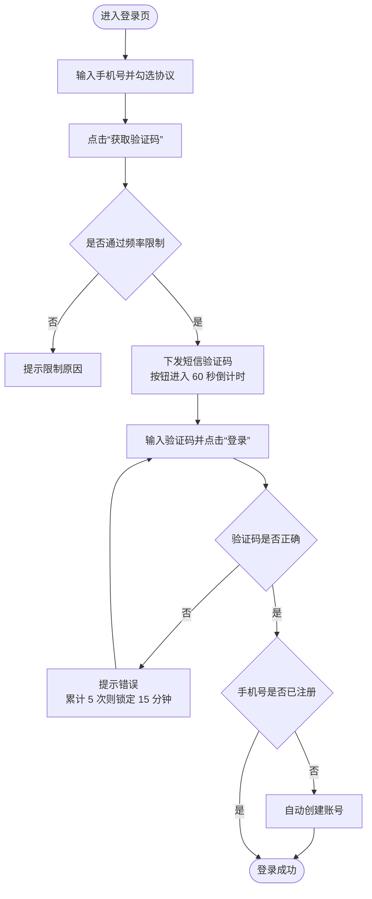

# 产品需求文档：手机号验证码登录

> 说明：本文为示例文档，所涉功能、数据与人员均为虚构，仅用于展示文档写法。

| 文档状态 | 版本 | 产品负责人 | 研发负责人 | 测试负责人 | 计划上线 | 最后更新 |
|---|---|---|---|---|---|---|
| 已评审 | V1.1 | 张三 | 李四 | 王五 | 2026-12-14（全量） | 2026-11-18 |

相关文档：[技术设计文档](02-tech-design.md) · [测试方案](03-test-plan.md) · [测试报告](04-test-report.md) · 交互设计稿（Figma 链接）

## 1. 概述

### 1.1 需求摘要

| 项目 | 内容 |
|---|---|
| 需求背景 | 密码登录的流失率高，密码找回占用大量客服资源，注册流程门槛高 |
| 解决方案 | 新增“手机号 + 短信验证码”登录方式；未注册的手机号在验证通过后自动完成注册 |
| 预期收益 | 登录转化率由 62% 提升至 75% 以上；密码重置工单减少 50% |
| 需求范围 | App 与 H5 的登录页、账号服务；不涉及第三方账号登录与海外手机号 |
| 上线计划 | 2026-12-09 开始灰度发布，2026-12-14 全量发布 |

### 1.2 阅读指引

| 读者 | 建议阅读章节 |
|---|---|
| 管理者、项目经理 | 第 1、2、3、9 章 |
| 研发、测试 | 第 4 至 8 章 |
| 设计、运营、客服 | 第 4、5 章及 6.8 节 |

文中的专业术语见附录 A。

## 2. 背景与问题

当前产品仅支持“账号 + 密码”登录。用户遗忘密码后须经找回流程才能登录，新用户注册须填写 4 项信息。这两个环节是登录与注册流失的主要来源，并持续产生客服成本。

| 问题 | 数据依据（2026 年 10 月） | 业务影响 |
|---|---|---|
| 登录流失率高 | 登录转化率为 62%；流失用户中 41% 止步于“忘记密码”环节 | 活跃用户流失 |
| 客服成本高 | 密码重置类工单约 1,800 单/月，占工单总量的 15% | 客服人力被占用 |
| 注册门槛高 | 注册须填写 4 项信息，注册完成率为 48% | 新用户获取受限 |

上述问题随用户规模增长而同步放大。同类产品已普遍提供验证码登录，继续缺失将构成体验上的劣势。

## 3. 目标与范围

### 3.1 目标与成功指标

| 编号 | 目标 | 衡量指标 | 基线 | 目标值 | 指标类型 | 评估时间 |
|---|---|---|---|---|---|---|
| G1 | 降低登录流失（用户目标） | 登录转化率 | 62% | ≥ 75% | 先行指标 | 全量后 2 周 |
| G2 | 降低注册门槛（用户目标） | 注册完成率 | 48% | ≥ 70% | 先行指标 | 全量后 2 周 |
| G3 | 降低客服成本（业务目标） | 密码重置工单量 | 1,800 单/月 | ≤ 900 单/月 | 滞后指标 | 全量后 1 个自然月 |
| G4 | 短信成本可控（约束） | 单次成功登录的短信消耗 | — | ≤ 1.3 条 | 护栏指标 | 持续监控 |

指标口径：

- 登录转化率 = 登录成功 UV ÷ 登录页曝光 UV
- 注册完成率 = 完成注册的新用户数 ÷ 到达登录页的新用户数
- 密码重置工单量 = 客服系统中“密码”类工单数
- 单次成功登录的短信消耗 = 验证码短信发送量 ÷ 验证码登录成功次数

### 3.2 非目标

| 非目标 | 原因 |
|---|---|
| 第三方账号登录（微信、Apple） | 属独立需求，另行立项 |
| 海外手机号 | 当前无海外业务 |
| 下线密码登录 | 密码登录保留为备用登录方式 |
| 登录页整体改版 | 本期仅新增登录方式，不调整既有页面结构 |

## 4. 用户故事

| 编号 | 用户角色 | 用户故事 | 对应需求 |
|---|---|---|---|
| US-1 | 遗忘密码的老用户 | 我希望凭手机号和短信验证码直接登录，以便无须找回密码即可进入账号 | R1、R2 |
| US-2 | 首次使用的新用户 | 我希望用手机号一步完成注册并登录，以便无须填写注册表单即可开始使用 | R1、R2、R3 |
| US-3 | 手机号持有人 | 我希望他人无法利用该功能向我的手机号频繁发送短信，以便不受骚扰 | R4 |
| US-4 | 平台运营方 | 我希望验证码短信的发送量受控，以便避免恶意调用造成费用损失 | R4、R6 |
| US-5 | 全体用户 | 我希望在短信通道出现异常时仍能收到验证码，以便登录不受单一通道故障的影响 | R5 |

## 5. 业务流程

## 6. 功能需求

### 6.1 需求总览

| 编号 | 需求名称 | 优先级 | 对应用户故事 | 备注 |
|---|---|---|---|---|
| R1 | 获取验证码 | P0 | US-1、US-2 | — |
| R2 | 验证码登录 | P0 | US-1、US-2 | — |
| R3 | 新用户自动注册 | P0 | US-2 | — |
| R4 | 防刷与频率限制 | P0 | US-3、US-4 | — |
| R5 | 短信通道容灾 | P1 | US-5 | — |
| R6 | 人机验证 | P2 | US-4 | 本期不实现，技术设计须预留接入点 |

优先级定义：P0 为必须具备，缺失则不可上线；P1 为应当具备，时间不足时可延后；P2 为后续规划，本期不实现，但设计须兼容。

每条验收标准具有唯一编号，技术设计文档与测试用例均按编号引用。

### 6.2 R1 获取验证码（P0）

**需求描述**：用户在登录页输入手机号后，可获取用于登录的短信验证码。系统对验证码的有效期与重发间隔加以限制。

**验收标准**

| 编号 | 前置条件 | 操作 | 预期结果 |
|---|---|---|---|
| R1-1 | 已输入合法手机号 | 点击“获取验证码” | 该手机号收到 6 位数字验证码短信 |
| R1-2 | 输入的手机号不合法 | — | “获取验证码”按钮置灰，不可点击 |
| R1-3 | 验证码发送成功 | 60 秒内再次获取 | 按钮显示剩余秒数且不可点击，不重复发送；满 60 秒后按钮恢复为“重新获取” |
| R1-4 | 验证码下发已超过 5 分钟 | 使用该验证码登录 | 登录失败，提示验证码已失效 |
| R1-5 | 已重新获取验证码 | 使用旧验证码登录 | 登录失败，提示验证码错误 |

合法手机号指 11 位中国大陆手机号：首位为 1，第 2 位为 3 至 9。

### 6.3 R2 验证码登录（P0）

**需求描述**：用户凭手机号与有效验证码完成登录。验证码仅可使用一次；输错次数达到上限后，该手机号的验证码登录被临时锁定。

**验收标准**

| 编号 | 前置条件 | 操作 | 预期结果 |
|---|---|---|---|
| R2-1 | 验证码正确且在有效期内 | 点击“登录” | 登录成功，返回登录前的页面；无来源页面时进入首页 |
| R2-2 | 验证码错误 | 点击“登录” | 登录失败，提示验证码错误；清空验证码输入框，停留在登录页 |
| R2-3 | 验证码已成功使用过一次 | 再次使用该验证码登录 | 登录失败，提示验证码已失效 |
| R2-4 | 同一验证码已累计输错 4 次 | 第 5 次输入错误的验证码 | 该验证码作废，手机号锁定 15 分钟。锁定期间无法使用验证码登录，也无法获取验证码；密码登录不受影响 |
| R2-5 | 未勾选《用户协议》与《隐私政策》 | 点击“登录” | 不发起登录，提示用户先阅读并同意协议。协议默认不勾选 |

### 6.4 R3 新用户自动注册（P0）

**需求描述**：未注册的手机号通过验证码验证后，系统自动创建账号并完成登录，用户无须进入独立的注册流程。

**验收标准**

| 编号 | 前置条件 | 操作 | 预期结果 |
|---|---|---|---|
| R3-1 | 手机号未注册，验证码正确 | 点击“登录” | 自动创建账号并登录成功，不展示注册页 |
| R3-2 | 账号由自动注册创建 | 查看个人资料 | 默认昵称为“用户”+ 手机尾号 4 位，例如“用户0000” |
| R3-3 | 同一未注册手机号 | 同时发起多次登录 | 仅创建一个账号 |

### 6.5 R4 防刷与频率限制（P0）

**需求描述**：限制验证码短信的发送频率，防止该功能被用于短信轰炸或恶意消耗短信费用。

**验收标准**

| 编号 | 前置条件 | 操作 | 预期结果 |
|---|---|---|---|
| R4-1 | 同一手机号当日已发送 10 条 | 再次获取验证码 | 不发送，提示当日次数已达上限。次日 0 点重置 |
| R4-2 | 同一 IP 在 1 小时内已发送 20 条 | 再次获取验证码 | 不发送，提示操作过于频繁 |
| R4-3 | 不经登录页，直接请求接口 | 获取验证码 | R1-3、R4-1、R4-2 的限制同样生效 |

### 6.6 R5 短信通道容灾（P1）

**需求描述**：接入主、备两条短信通道，降低单一通道故障对登录的影响。

**验收标准**

| 编号 | 前置条件 | 操作 | 预期结果 |
|---|---|---|---|
| R5-1 | 主通道发送失败 | 获取验证码 | 系统自动改由备用通道发送，用户无感知 |
| R5-2 | 主、备通道均发送失败 | 获取验证码 | 提示短信发送失败。本次不计入发送次数，不进入倒计时，用户可立即重试 |

### 6.7 R6 人机验证（P2）

本期不实现。当灰度期间的限流命中率超过阈值（见待决事项 Q3）时，在发送验证码前增加图形验证码校验。技术设计须预留接入点。

### 6.8 异常提示文案

| 场景 | 提示文案 |
|---|---|
| 手机号格式不正确 | 请输入正确的手机号 |
| 未勾选协议即点击登录 | 请先阅读并同意用户协议和隐私政策 |
| 发送过于频繁（60 秒内重发、IP 超限） | 操作过于频繁，请稍后再试 |
| 当日发送次数达到上限 | 今日获取次数已达上限，请明天再试 |
| 验证码错误 | 验证码错误，请重新输入 |
| 验证码已过期或已使用 | 验证码已失效，请重新获取 |
| 输错达 5 次，或在锁定期间操作 | 错误次数过多，请 15 分钟后再试 |
| 短信发送失败 | 短信发送失败，请稍后重试 |
| 网络异常 | 网络异常，请稍后重试 |

## 7. 非功能需求

| 类别 | 要求 |
|---|---|
| 性能 | 发送验证码接口与登录接口的 P99 响应时间低于 300ms，错误率低于 0.1% |
| 容量 | 支持峰值 100 QPS |
| 可用性 | 验证码登录功能的月度可用性不低于 99.9% |
| 短信到达 | 10 秒内到达率不低于 95% |
| 安全与隐私 | 验证码不得出现在接口返回与日志中；手机号在页面与日志中脱敏展示，如 `138****0000` |
| 兼容性 | iOS 15 及以上、Android 9 及以上、主流浏览器 H5；支持系统短信验证码自动填充 |

## 8. 数据埋点

转化漏斗：登录页曝光 → 点击“获取验证码” → 点击“登录” → 登录成功。

| 事件 | 触发时机 | 参数 |
|---|---|---|
| `login_page_view` | 登录页曝光 | `source`（来源页面） |
| `sms_code_click` | 点击“获取验证码” | `result`、`fail_reason` |
| `sms_login_click` | 点击“登录” | `result`、`fail_reason`、`is_new_user` |

## 9. 里程碑、依赖与风险

### 9.1 里程碑

| 里程碑 | 日期 | 负责人 |
|---|---|---|
| 需求评审 | 11-18 | 张三 |
| 技术设计评审 | 11-20 | 李四 |
| 开发与自测 | 11-23 至 12-01 | 李四 |
| 测试 | 12-02 至 12-08 | 王五 |
| 灰度发布（5% → 30%） | 12-09 至 12-10 | 李四 |
| 全量发布 | 12-14 | 李四 |

### 9.2 外部依赖

| 依赖事项 | 责任方 | 最晚完成时间 | 状态 |
|---|---|---|---|
| 备用短信通道的签名与模板审核 | 短信供应商（对接人：李四） | 11-25 | 进行中 |
| 《隐私政策》补充“手机号用于登录验证”的说明 | 法务 | 12-01 | 进行中 |
| 存量重复手机号的数据清洗 | 研发、客服 | 12-08 | 未开始 |

### 9.3 风险

| 风险 | 可能性 | 影响 | 应对措施 |
|---|---|---|---|
| 验证码接口被恶意调用，造成用户骚扰与短信费用损失 | 高 | 高 | R4 频率限制；短信发送量监控告警；R6 人机验证作为后备手段 |
| 短信到达率不达标，用户无法登录 | 中 | 高 | R5 主备通道；灰度期监控短信发送成功率 |
| 功能回滚期间，仅通过验证码注册的用户无法登录 | 低 | 中 | 逐步放量以降低回滚概率；回滚后优先修复并重新开放（另见待决事项 Q1） |

## 10. 待决事项

| 编号 | 问题 | 负责角色 | 是否阻塞开发 | 期望结论时间 |
|---|---|---|---|---|
| Q1 | 是否引导通过验证码注册的新用户设置登录密码？ | 产品、设计 | 否 | 12-01 |
| Q2 | 手机号被锁定时，是否向该手机号发送安全提醒？ | 产品、安全 | 否 | 12-01 |
| Q3 | 触发 R6 人机验证的限流命中率阈值暂定为 1%，待确认 | 安全 | 否 | 灰度结束前 |

## 附录 A 术语表

| 术语 | 说明 |
|---|---|
| P0 / P1 / P2 | 优先级，定义见 6.1 节 |
| UV | 独立访客数，同一用户在统计周期内只计一次 |
| 先行指标 / 滞后指标 | 前者在上线后数日至数周即可观察；后者需数周至数月才能体现 |
| 护栏指标 | 不追求提升、但不允许恶化的指标 |
| P99 | 99% 的请求的响应时间不超过该值，用于衡量接口性能 |
| QPS | 每秒请求数 |
| 灰度发布 | 先向小比例用户开放新功能，确认无异常后再逐步扩大范围 |
| 短信轰炸 | 利用验证码接口向他人手机号批量发送短信的恶意行为 |

## 附录 B 变更记录

| 版本 | 日期 | 变更内容 | 变更原因 | 修改人 |
|---|---|---|---|---|
| V1.1 | 11-18 | R2-4 的锁定时长由 30 分钟调整为 15 分钟 | 需求评审意见：30 分钟对正常用户影响过大 | 张三 |
| V1.0 | 11-16 | 初稿 | — | 张三 |
