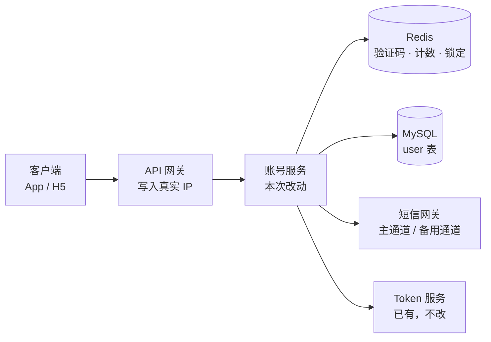
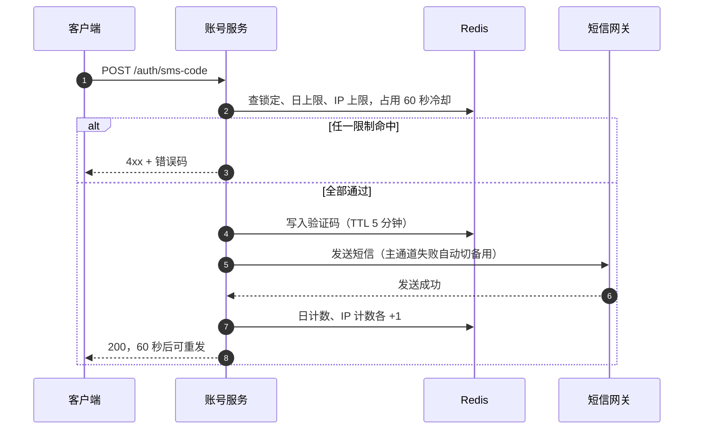
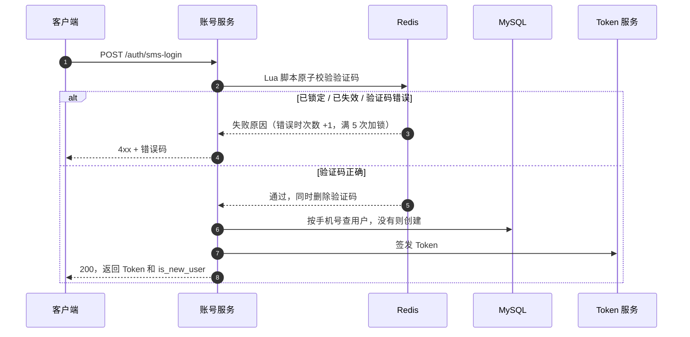

# 技术方案：手机号验证码登录

> 示例文档。功能、数据、人名均为虚构，只用来展示写法。

| 状态 | 作者 | 评审人 | 对应需求 | 最后更新 |
|---|---|---|---|---|
| 已评审 | 李四 | 赵六（架构）· 钱七（安全）· 王五（测试） | [PRD](01-prd.md) | 2026-11-20 |

## 1. 概述

- **做什么**：账号服务新增“发送验证码”“验证码登录”两个接口；未注册的手机号登录时自动建号。
- **怎么做**：验证码、频控计数、锁定状态都放 Redis，靠 TTL 自动过期；短信走主备双通道；登录态复用现有 Token 服务。
- **影响面**：只改账号服务；user 表加 1 个字段和 1 个唯一索引；现有密码登录不受影响。

## 2. 目标与非目标

| 目标 | 怎么验证 |
|---|---|
| 实现 PRD 的 R1–R5 全部规则 | 测试用例全覆盖 |
| 发码、登录接口 P99 < 300ms（100 QPS 下） | 压测 |
| 短信被刷时损失可控：单号每天最多 10 条 | 限流 + 发送量告警 |
| 出问题能一键回滚 | 功能开关 |

非目标：不改 Token 机制；不做图形验证码（只预留接入点）。

## 3. 整体设计

### 3.1 架构



限流用的 IP 取网关写入的 `X-Real-IP`，不信任客户端传来的 `X-Forwarded-For`。

### 3.2 发送验证码



### 3.3 验证码登录



## 4. 详细设计

### 4.1 接口

**发送验证码** `POST /api/v1/auth/sms-code`

```jsonc
// 请求
{ "phone": "13800000000" }

// 响应
{ "code": 0, "message": "ok", "data": { "resend_after": 60 } }
```

**验证码登录** `POST /api/v1/auth/sms-login`

```jsonc
// 请求
{ "phone": "13800000000", "code": "123456" }

// 响应
{
  "code": 0,
  "message": "ok",
  "data": {
    "access_token": "eyJ...",
    "refresh_token": "eyJ...",
    "expires_in": 7200,
    "is_new_user": false
  }
}
```

**错误码**（用户文案见 PRD 第 7 节）

| 错误码 | HTTP | 含义 | 对应规则 |
|---|---|---|---|
| 40001 | 400 | 手机号格式错误 | R1-2 |
| 40101 | 401 | 验证码错误 | R2-2 |
| 40102 | 401 | 验证码已失效（过期、已使用、未获取） | R1-4、R2-3 |
| 40300 | 403 | 功能未开放（开关关闭或未命中灰度） | — |
| 42301 | 423 | 手机号已锁定 | R2-4 |
| 42901 | 429 | 60 秒内重复发送 | R1-3 |
| 42902 | 429 | 手机号当日发送超限 | R4-1 |
| 42903 | 429 | IP 每小时发送超限 | R4-2 |
| 50301 | 503 | 短信发送失败（主备都失败） | R5-2 |

### 4.2 Redis

| Key | 值 | TTL | 用途 |
|---|---|---|---|
| `sms:code:{phone}` | Hash：`hmac`（验证码的 HMAC-SHA256）、`fails`（已输错次数） | 300s | 验证码 |
| `sms:cd:{phone}` | 1 | 60s | 重发冷却 |
| `sms:day:{phone}:{yyyyMMdd}` | 计数 | 到当日 24:00 | 手机号日上限 |
| `sms:ip:{ip}:{yyyyMMddHH}` | 计数 | 3600s | IP 小时上限（按自然小时） |
| `sms:lock:{phone}` | 1 | 900s | 输错锁定 |

Redis Cluster 下，手机号部分用 hash tag 包裹，保证 Lua 脚本涉及的 key 落在同一个槽。

### 4.3 MySQL

```sql
ALTER TABLE user
  ADD COLUMN register_source VARCHAR(16) NOT NULL DEFAULT 'password'
      COMMENT '注册来源：password / sms',
  ADD UNIQUE KEY uk_phone (phone);
```

- 没绑手机号的老账号 `phone` 为 NULL，唯一索引允许多个 NULL，不受影响。
- 线上现有 312 条重复手机号，加索引前必须先清洗，见第 6 节。

### 4.4 关键逻辑

**发码**（按执行顺序）

| 步骤 | 动作 | 不通过时 |
|---|---|---|
| 1 | 校验手机号格式 | 40001 |
| 2 | 查 `sms:lock` | 42301 |
| 3 | 读日计数、IP 计数 | 42902 / 42903 |
| 4 | `SET sms:cd:{phone} 1 NX EX 60`，同时充当同一手机号的并发锁 | 42901 |
| 5 | 用安全随机数生成 6 位验证码，写 `sms:code`（覆盖旧值，旧码即失效） | — |
| 6 | 调短信网关：主通道超时 2 秒或失败，自动切备用通道 | 删除 `sms:cd` 和 `sms:code`，返回 50301 |
| 7 | 日计数、IP 计数各 +1 | — |

IP 计数是“先读后加”，高并发下可能略超 20 条。这里是粗粒度防刷，可以接受。

**登录校验**（一个 Lua 脚本内原子完成，避免并发时同一验证码被用两次）

| 步骤 | 判断 | 结果 |
|---|---|---|
| 1 | `sms:lock` 存在 | 42301 |
| 2 | `sms:code` 不存在 | 40102 |
| 3 | HMAC 不匹配 | `fails` +1。满 5 次：删 `sms:code`，写 `sms:lock`，返回 42301；否则返回 40101 |
| 4 | HMAC 匹配 | 删 `sms:code`，通过 |

**自动注册**：直接 `INSERT`，由 `uk_phone` 兜底；遇到唯一键冲突就改为查询已有账号。

**安全**：Redis 只存验证码的 HMAC，不存明文；任何日志都不打印验证码，手机号脱敏后再打印。

### 4.5 配置项

PRD 里的数值全部做成配置，测试环境可以调小。

| 配置 | 默认值 | 对应规则 |
|---|---|---|
| `sms_login.enabled` | false | 功能总开关，回滚用 |
| `sms_login.gray_percent` | 0 | 灰度比例 |
| `sms.code_ttl_seconds` | 300 | R1-4 |
| `sms.resend_interval_seconds` | 60 | R1-3 |
| `sms.max_fails` | 5 | R2-4 |
| `sms.lock_seconds` | 900 | R2-4 |
| `sms.daily_limit_per_phone` | 10 | R4-1 |
| `sms.hourly_limit_per_ip` | 20 | R4-2 |

## 5. 方案选型

| 决策点 | 选择 | 放弃的方案 | 理由 |
|---|---|---|---|
| 验证码存哪 | Redis | MySQL | 自带 TTL；验证码丢了可以重发，不需要持久化 |
| 短信怎么发 | 同步调用 | MQ 异步 | 用户在等短信，失败要立刻告知；100 QPS 同步扛得住 |
| 限流放哪 | 账号服务内 | 网关插件 | 规则按手机号限流，网关只能按 IP 和路径 |
| 怎么保证校验原子 | Lua 脚本 | 分布式锁 | 一次往返完成“比对、计数、删除”，没有锁开销 |

## 6. 风险与应对

| 风险 | 应对 |
|---|---|
| 短信被刷，产生费用 | R4 限流；短信日发送量告警；预留图形验证码接入点 |
| 线上有 312 条重复手机号，唯一索引加不上 | 上线前清洗：保留最近活跃账号的手机号，其余置空，名单同步客服 |
| Redis 不可用 | 发码、登录接口直接返回失败，不降级放行（否则限流被绕过）；登录页展示密码登录入口 |
| 短信通道故障 | 主备自动切换；主备都失败时电话告警 |

## 7. 监控告警

| 指标 | 告警阈值 | 级别 |
|---|---|---|
| 短信发送成功率 | 5 分钟内 < 95% | P0，电话 |
| 接口 5xx 比例 | 5 分钟内 > 1% | P0，电话 |
| 接口 P99 | 5 分钟内 > 300ms | P1，群通知 |
| 限流命中次数 | 环比涨 3 倍 | P1，群通知（可能被刷） |
| 短信日发送量 | 超过预算的 120% | P1，群通知 |

## 8. 上线与回滚

| 步骤 | 日期 | 动作 | 观察 |
|---|---|---|---|
| 1 | 12-08 | 清洗重复手机号，低峰期加唯一索引 | DDL 无报错 |
| 2 | 12-09 | 发布代码，开关保持关闭 | 密码登录无异常 |
| 3 | 12-09 | 打开开关，灰度 5% | 短信成功率、登录成功率 |
| 4 | 12-10 | 灰度 30% | 同上，加看短信消耗 |
| 5 | 12-14 | 全量 | 同上 |

**回滚**：关闭 `sms_login.enabled`，1 分钟内生效，登录页只剩密码登录。数据不用回滚。

**回滚的代价**：只用验证码注册的新用户没有密码，回滚期间无法登录。所以回滚后要尽快修复重开。

## 9. 排期

后端 1 人，11-23 ~ 12-01。

| 任务 | 人日 |
|---|---|
| 发码接口（含冷却、限流） | 2 |
| 登录接口（Lua 校验、锁定、自动注册） | 2 |
| 短信主备切换 | 1 |
| 重复手机号清洗脚本、加索引 | 0.5 |
| 开关、监控、告警 | 0.5 |
| 联调与自测 | 1 |
| **合计** | **7** |

## 10. 待决问题

| 问题 | 负责人 | 截止 |
|---|---|---|
| 备用短信通道的签名和模板审核 | 李四 | 11-25 |
