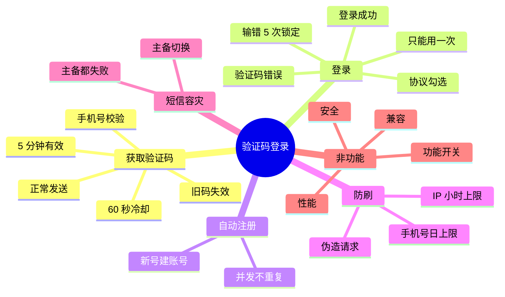

# 测试方案：手机号验证码登录

> 示例文档。功能、数据、人名均为虚构，只用来展示写法。

| 状态 | 测试 | 评审人 | 对应文档 | 最后更新 |
|---|---|---|---|---|
| 已评审 | 王五 | 张三（产品）· 李四（研发） | [PRD](01-prd.md) · [技术方案](02-tech-design.md) | 2026-11-27 |

## 1. 概要

| 项 | 内容 |
|---|---|
| 测什么 | 验证码登录全流程：发码、登录、自动注册、防刷、短信容灾 |
| 重点 | 防刷限流、输错锁定、并发下验证码只能用一次。这三处出错就是资损或安全问题 |
| 用例 | 23 条（P0 13 条、P1 8 条、P2 2 条），其中 18 条做成接口自动化 |
| 时间 | 12-02 ~ 12-08，测试 1 人 |

## 2. 范围

| 测 | 不测 |
|---|---|
| PRD 的 R1–R5 全部规则 | 密码登录：没改动，只跑现有回归 |
| 非功能：安全、性能、兼容 | Token 服务：没改动 |
| 功能开关（回滚手段） | 运营商侧的短信到达率：灰度期看监控 |

## 3. 策略

| 类型 | 怎么测 | 用例 |
|---|---|---|
| 功能 | 规则都在服务端，以接口自动化为主；UI 手工走主流程 | TC-01 ~ 19、TC-23 |
| 安全 | 查接口返回、日志、Redis 里有没有明文验证码 | TC-20 |
| 性能 | 发码、登录接口各 100 QPS 压 10 分钟 | TC-21 |
| 兼容 | iOS、Android、H5 各 2 款主流机型走主流程 | TC-22 |
| 回归 | 现有登录模块的自动化用例（密码登录、退出、Token 刷新） | 现有 86 条 |

## 4. 环境与数据

| 项 | 说明 |
|---|---|
| 测试环境 | 短信走 Mock 通道，验证码从 Mock 查询接口取；可模拟主、备通道失败 |
| 预发环境 | 真实短信通道，白名单手机号，主备通道各验证 1 次 |
| 时间类用例 | 测试环境把有效期、冷却、锁定时长调小后跑自动化；预发用真实值各跑 1 次 |
| 测试数据 | 已注册手机号 5 个；未注册号段 1 个，自动化专用，跑完清理账号和 Redis key |

## 5. 准入与准出

| 阶段 | 标准 |
|---|---|
| 准入（提测） | 研发自测通过冒烟用例 TC-01、TC-06、TC-12；测试环境已部署，Mock 短信可用 |
| 准出（上线） | ① P0、P1 用例 100% 通过 ② P0、P1 缺陷全部关闭；P2 遗留不超过 3 个且产品确认 ③ 性能达到 PRD 第 8 节的指标 ④ 接口自动化接入 CI 且全部通过 |

## 6. 测试点总览

## 7. 测试用例

- **需求**：PRD 的规则编号。
- **预期**里的数字是技术方案 4.1 节的错误码。
- **自动化**：✓ 表示已做成接口自动化并接入 CI。

### 获取验证码

| ID | 需求 | 级别 | 场景 | 步骤 | 预期 | 自动化 |
|---|---|---|---|---|---|---|
| TC-01 | R1-1 | P0 | 正常获取 | 输入合法手机号，点“获取验证码” | 收到 6 位数字验证码；按钮开始 60 秒倒计时 | ✓ |
| TC-02 | R1-2 | P0 | 手机号不合法 | 分别输入：10 位、12 位、含字母、以 2 开头、第 2 位为 2 | 按钮置灰；直调接口返回 40001，不发短信 | ✓ |
| TC-03 | R1-3 | P0 | 60 秒冷却（边界） | 发码成功后，第 59 秒、第 61 秒各请求一次 | 第 59 秒返回 42901，不发短信；第 61 秒发送成功 | ✓ |
| TC-04 | R1-4 | P1 | 5 分钟有效期（边界） | 发码后第 4 分 59 秒、第 5 分 01 秒，各用正确验证码登录（分两次执行） | 前者登录成功；后者返回 40102 | ✓ |
| TC-05 | R1-5 | P1 | 旧验证码失效 | 获取验证码 A，61 秒后获取验证码 B；先用 A 登录，再用 B 登录 | A 返回 40101；B 登录成功 | ✓ |

### 登录

| ID | 需求 | 级别 | 场景 | 步骤 | 预期 | 自动化 |
|---|---|---|---|---|---|---|
| TC-06 | R2-1 | P0 | 老用户登录 | 已注册手机号 + 正确验证码 | 登录成功；`is_new_user=false`；不新建账号 | ✓ |
| TC-07 | R2-2 | P0 | 验证码错误 | 输入错误的验证码，点“登录” | 返回 40101；输入框清空，停留在登录页 | ✓ |
| TC-08 | R2-3 | P0 | 验证码只能用一次 | 登录成功后退出，用同一个验证码再登录 | 返回 40102 | ✓ |
| TC-09 | R2-4 | P0 | 输错锁定（边界） | ① 输错 4 次后，输入正确验证码 ② 换一个手机号，输错 5 次后，输入正确验证码，再点“获取验证码” | ① 登录成功 ② 第 5 次输错返回 42301；之后正确验证码、获取验证码都返回 42301 | ✓ |
| TC-10 | R2-4 | P1 | 锁定解除 | 锁定满 15 分钟后，重新获取验证码并登录 | 登录成功 | ✓ |
| TC-11 | R2-5 | P0 | 未勾选协议 | 打开登录页，不勾选协议，点“登录” | 协议默认未勾选；提示先同意协议；不发起登录请求 | — |

### 自动注册

| ID | 需求 | 级别 | 场景 | 步骤 | 预期 | 自动化 |
|---|---|---|---|---|---|---|
| TC-12 | R3-1、R3-2 | P0 | 新手机号自动注册 | 未注册手机号 + 正确验证码 | 登录成功；`is_new_user=true`；新建 1 个账号，昵称为“用户”+ 尾号 4 位 | ✓ |
| TC-13 | R3-3 | P1 | 并发不重复建号 | 同一个未注册手机号 + 正确验证码，并发发 10 个登录请求 | 只有 1 个成功；user 表里该手机号只有 1 条记录 | ✓ |

### 防刷

| ID | 需求 | 级别 | 场景 | 步骤 | 预期 | 自动化 |
|---|---|---|---|---|---|---|
| TC-14 | R4-1 | P0 | 手机号日上限（边界） | 同一手机号当天第 10 次、第 11 次获取，每次间隔超过 60 秒 | 第 10 次成功；第 11 次返回 42902 | ✓ |
| TC-15 | R4-1 | P2 | 次日重置 | 达到日上限后，次日 0 点后再获取 | 发送成功 | — |
| TC-16 | R4-2 | P1 | IP 小时上限（边界） | 同一 IP 换不同手机号，同一小时内第 20 次、第 21 次获取 | 第 20 次成功；第 21 次返回 42903 | ✓ |
| TC-17 | R4-3 | P0 | 伪造请求绕过限制 | 用脚本直调发码接口，伪造 `X-Forwarded-For` 换 IP，重复 TC-16 | 伪造无效，第 21 次仍返回 42903 | ✓ |

### 短信容灾

| ID | 需求 | 级别 | 场景 | 步骤 | 预期 | 自动化 |
|---|---|---|---|---|---|---|
| TC-18 | R5-1 | P1 | 主通道失败 | Mock 主通道失败，获取验证码 | 自动走备用通道，收到验证码；接口返回成功 | ✓ |
| TC-19 | R5-2 | P1 | 主备都失败 | Mock 主备通道都失败，获取验证码；恢复通道后立即再获取 | 第一次返回 50301，按钮不进入倒计时；恢复后立即获取成功；当日次数只计 1 次 | ✓ |

### 非功能与上线保障

| ID | 需求 | 级别 | 场景 | 步骤 | 预期 | 自动化 |
|---|---|---|---|---|---|---|
| TC-20 | 安全 | P0 | 验证码不泄露 | 发码后检查接口返回、服务日志、Redis | 三处都没有明文验证码；日志里的手机号已脱敏 | — |
| TC-21 | 性能 | P1 | 接口压测 | 发码、登录接口各 100 QPS 持续 10 分钟 | P99 < 300ms；错误率 < 0.1% | — |
| TC-22 | 兼容 | P2 | 多端主流程 | iOS、Android、H5 各 2 款机型，走“获取验证码 → 自动填充 → 登录” | 流程通畅，验证码能自动填充 | — |
| TC-23 | 开关 | P0 | 关闭开关即回滚 | 关闭 `sms_login.enabled`，打开登录页，并直调两个接口 | 登录页只有密码登录；接口返回 40300；密码登录正常 | ✓ |

## 8. 风险

| 风险 | 应对 |
|---|---|
| 测试环境验证不了真实短信到达 | 预发用白名单真机号，主备通道各验证 1 次 |
| 限流用例会把测试 IP 和手机号打满，影响其他人 | 自动化用专用号段，执行后清理 Redis key |
| 兼容机型覆盖有限 | 灰度期按机型看“获取验证码 → 登录成功”的转化率 |

## 9. 排期

| 日期 | 内容 |
|---|---|
| 12-02 | 冒烟；接口自动化首轮 |
| 12-02 ~ 12-04 | 功能测试，执行全部用例 |
| 12-07 | 性能、安全、兼容；预发验证真实短信 |
| 12-08 | 缺陷回归，P0 用例全量回归；出测试报告 |
