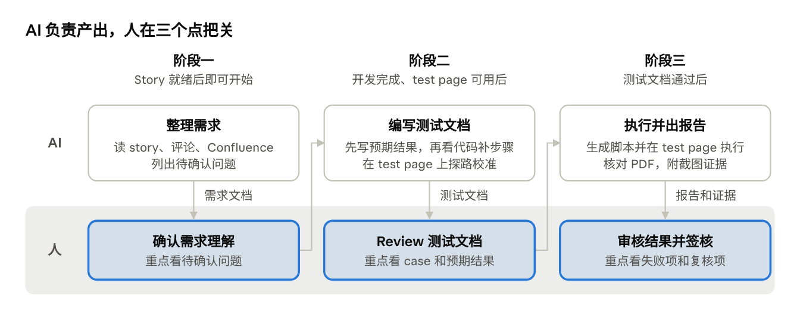

# 新功能 UAT 自动化测试方案

2026-11-16 · 评审稿

建议用 Copilot（agent 模式）加 Playwright，把新功能 UAT 里读需求、写用例、执行、取证这四件事交给 AI，人只在三个点审核：需求理解、测试文档、执行结果。本文是评审稿，用来确认整体设计，并决定是否启动试点。

## 要解决的问题

新功能测试目前几乎全靠人，而且每个 story 都要从头做一遍。Tester 拿到 Jira story 后要先读懂需求，再到开发提供的 test page 上找到改动的位置，逐条验证 AC，最后截图留证据。

费人的地方主要有四处：

- **读需求**：每个 BA 写 story 的格式不一样，关键信息经常散落在评论、附件和 Confluence 里。
- **组合多**：一条 AC 常常要求“HK 所有产品都满足，某几个除外”，每个产品都要进系统走一遍。
- **反复复测**：开发修完缺陷后，同样的步骤要重新做一遍。
- **取证**：每条结论都要截图，还要核对打印出来的 PDF。

现有的回归自动化解决不了这个问题。回归脚本是针对已有功能提前写好的，新功能没有现成脚本，改动出现在页面的哪个位置也要现找。

## 方案概览

流程分三个阶段，每个阶段都是 AI 先产出，人审核通过后才进入下一阶段。

发现缺陷时，开发修复后重跑同一个脚本即可复测。Story 验收通过后，再把这次的变化更新到系统知识库。

| 阶段 | 什么时候做 | AI 做什么 | 产出 | 人做什么 |
| --- | --- | --- | --- | --- |
| 一、整理需求 | Story 就绪 | 读 story、评论、附件和 Confluence，整理成固定格式，列出待确认问题 | 标准需求文档 | 确认 AI 的理解是否正确 |
| 二、编写测试文档 | 开发完成，test page 可用 | 先写预期结果，再看代码补充操作步骤，并在 test page 上探路校准 | 测试文档 | Review 一次 |
| 三、执行与报告 | 测试文档通过后 | 生成脚本并执行，核对页面和 PDF，收集证据 | 脚本、报告、证据 | 指定 customer ID，审核结果并签核 |

支撑这三个阶段的是系统知识库，它让 AI 知道系统有哪些 tab、怎么从 test page 走到被测的页面。

## 阶段一：从 Jira story 到标准需求文档

这一步把格式各异的 story 整理成固定格式的需求文档，并把含糊的地方挑出来。它不依赖代码，story 写好就可以做，不用等开发完成。

**输入**：Tester 给出 story 链接。AI 通过 Jira 和 Confluence 的接口读取正文、全部评论、附件，以及 story 里贴出的 Confluence 页面。

**AI 做什么**：

- 合并正文和评论。评论改过 AC 的，以最新的为准，并注明改了什么。
- 每条需求标明出处，比如“来自 AC3”或“来自 BA 11 月 14 日的评论”。
- 把 story 没写清楚、互相矛盾或待定的内容列成“待确认问题”，不自己猜。

**产出**：标准需求文档，章节固定。

| 章节 | 内容 |
| --- | --- |
| 范围 | 适用的市场和产品，排除项 |
| 功能需求 | 逐条编号，每条带出处 |
| 文案 | 需要逐字核对的文字 |
| 待确认问题 | 问题、影响哪条需求、是否阻塞测试 |
| 信息来源 | 读过的评论、附件、Confluence 页面，以及 story 的最后更新时间 |

**人做什么**：Tester 确认 AI 的理解是否正确，重点看待确认问题，需要 BA 回答的转给 BA。确认后文档标记为“已通过”，才能进入阶段二。

提前做的好处是，待确认问题可以在开发动手之前回到 BA 那里，这时候改需求最便宜。

**Story 中途变更**：执行前工具自动比对 story 的最后更新时间。有变化就提示重新生成，人只需要重审改动的部分。

## 阶段二：从需求文档到测试文档

这一步在开发完成、test page 可用之后做，产出一份步骤已经在真实页面上走通过的测试文档，人只 review 一次。

**AI 分三小步完成，中间不需要人参与**：

1. **写预期结果，不看代码。** 只根据已通过的需求文档，写出每条 case 的目的、对应需求、测试数据和预期结果，并存档。
2. **补操作步骤，可以看代码。** 读系统知识库和本次改动的代码，补上从 test page 进入系统到完成验证的详细步骤：进哪个 tab、填哪些必填项、点哪个按钮。这一步不许修改预期结果。
3. **探路校准。** 在 test page 上按步骤实际走一遍，只确认每一步能操作，不判断结果对不对。走不通的步骤按实际页面修正。

**为什么要分开写**：本次改动的代码正是被测对象。如果 AI 看着代码写预期结果，就会把代码的实际行为当成正确答案，测试永远通过。分开之后，工具自动比对第 1 步的存档和最终文档：预期结果被改过的，或者找不到需求出处的，单独标出来给人看。

**为什么要探路**：只看代码推断页面并不可靠，代码里有条件显示、后端返回的数据和功能开关。先探路再 review，可以避免人 review 通过之后才发现步骤走不通、文档返工。

**产出**：测试文档，每条 case 分两层。

| 层 | 内容 | 谁看 |
| --- | --- | --- |
| 概要 | 目的、对应的需求和 AC、测试数据、预期结果 | 人重点看 |
| 详细步骤 | 逐步操作，用页面上看得见的文字描述，如“在 Relationship 下拉中选择 Grandchild” | 主要给 AI 转脚本用，人扫一眼 |

文档里还有三张清单：

- **AC 覆盖表**：每条 AC 对应哪些 case，没有 case 覆盖的 AC 会被标出来。
- **不测或阻塞的项**：比如文案还没提供，写明原因。
- **需人工复核的项**：比如页面和 mockup 是否一致，AI 只负责截图。

对“所有产品”这类 AC，文档写明要跑的产品清单，执行时跑全部组合，不抽样。

**人做什么**：review 一次，重点看概要层：case 有没有漏，预期结果对不对。发现问题可以直接改文档，也可以让 AI 改。通过后标记为“已通过”。

## 阶段三：生成脚本、执行、出报告

AI 把已通过的测试文档转成固定的 Playwright 脚本来执行，而不是每次临场操作页面。脚本每次检查的内容完全一样，复测时直接重跑，不再消耗 AI。

**怎么启动**：Tester 指定这次用哪个 customer ID，然后启动执行。脚本和人一样，在 test page 上点产品按钮进入系统，填完前面 tab 的必填项，走到被测的 tab。AI 不判断 customer ID 能不能用，需要换 ID 时由人告诉它。

**通用前置脚本**：“从 test page 走到某个 tab”这一段对所有 story 都一样，做成一个按产品传参数的通用脚本，所有 story 复用。每个 story 只需要写最后那一小段。

**结果有五种状态**：

| 状态 | 含义 | 人要做什么 |
| --- | --- | --- |
| 通过 | 每条预期结果都验证到了 | 抽查证据 |
| 失败 | 实际结果和预期不符 | 确认后提缺陷 |
| 前置步骤未通过 | 还没走到被测功能就失败了 | 判断是 customer ID、环境还是缺陷，换 ID 重跑 |
| 需人工复核 | AI 拿不准，或者文档指定由人判断 | 看截图下结论 |
| 阻塞 | 缺条件，没有执行 | 条件具备后再跑 |

**报告内容**：

- 每条预期结果都列出预期值、实际值和截图。人看证据就能判断，不需要读脚本。
- AC 覆盖表：每条 AC 的结论，来自它下面所有 case 的结果。
- 失败项附带缺陷草稿：复现步骤、预期、实际、截图，可以直接贴到 Jira。
- 步骤偏差：执行时页面和文档步骤对不上的地方，单独列出，不直接判失败，也不悄悄绕过去。

**PDF 验证**：脚本下载系统生成的 Form，分两部分核对。

- 文字：直接提取 PDF 里的文字，和需求文档里的文案逐字比对。
- 复选框和多选框：先用文字定位到对应的声明或选项，再截取它旁边的方框区域判断是否勾选，报告里附上这个小截图供人抽查。

**复测**：开发修完缺陷后重跑同一个脚本。脚本跑不通（比如页面结构变了）时才让 AI 介入修复，修复只能改操作方式，不能改检查的内容。

**人做什么**：看报告，重点是失败项、需人工复核项和步骤偏差，通过项抽查。最终签核仍然由人负责。

## 系统知识库

知识库是 AI 了解系统的依据，分两层：一层小而稳定，由人负责；另一层从代码现读，不手工维护。

不建议把全部代码转成一份详细文档来维护。那样的文档是代码的副本，代码每个版本都在变，副本一定会过期，而且总结错了会带进以后的每一个 story。

| 层 | 内容 | 怎么维护 |
| --- | --- | --- |
| 系统地图 | test page 怎么用；有哪些 tab 和它们的顺序，如 Policy Insured、Beneficiary、健康问答；每个 tab 对应哪个仓库的哪部分代码；过每个 tab 最少要填什么；产品之间的差异；术语 | AI 读代码起草，资深 Tester 审核并负责。只有流程或 tab 变了才改 |
| 细节 | 字段、校验规则、页面元素 | 不单独保存。写测试文档时由 AI 从当前代码现读 |

**怎么建立**：一次性工作。AI 分模块、分 tab 逐个读代码起草系统地图，再在 test page 上照着地图走一遍验证，最后由资深 Tester 审核。

**维护规则**：

1. **放在 Git 仓库里。** 每次修改有记录，要经过 review。
2. **Story 验收通过之后才更新。** 测试期间，新功能的信息只放在这个 story 自己的目录里。还没验证的行为不能进知识库，否则它就成了“已知的正确行为”。
3. **按本次改动增量更新。** 新增或删除的 tab、必填项、流程变化，由 AI 起草更新，负责人审核。
4. **纠错要回流。** Tester review 时改过的地方、执行时踩过的坑，写回系统地图，同样的错不犯第二次。
5. **记录对应的代码版本。** 系统地图每一节注明它对应的代码版本。使用前工具自动比对，代码变了而地图没更新的，提示检查。

**知识库和本次改动的代码，用法不同**：

- 知识库记录的是已经验收过的行为，可以当判断依据。比如“原有功能不受影响”这类 AC，就靠它来确定原来是什么样。
- 本次改动的代码是被测对象，只能用来写操作步骤，不能用来写预期结果。

## 保证结果可信的规则

AI 最危险的错误是“报了通过，其实没验到”。下面六条规则的目的，是让这类错误要么不发生，要么被人看见。

| 规则 | 防的是什么 | 怎么落实 |
| --- | --- | --- |
| 不猜需求 | AI 自己补全 story 没写的内容 | 没写清楚的一律列为待确认问题 |
| 预期结果只来自需求文档 | 拿代码推结果，测试永远通过 | 先写预期再看代码；工具自动比对；每条预期结果都有需求出处 |
| 脚本不能偏离文档 | 脚本检查得比文档松，或者漏了某一条 | 文档里的每条预期结果在报告里都要有对应结果，没有的标为“未执行” |
| 每条结论都有证据 | 报了通过但其实没验到 | 报告列出预期值、实际值、截图 |
| 拿不准就交给人 | AI 硬下结论 | 标为“需人工复核”，附截图 |
| 不悄悄绕过问题 | 把缺陷当成数据或环境问题绕过去 | 前置步骤失败和步骤偏差单独列出；换 customer ID 由人决定 |

## 人的工作量

每个 story 人介入三次，每次只看重点；另外有三项一次性投入。

| 介入点 | 时机 | 重点看什么 | 不用细看什么 |
| --- | --- | --- | --- |
| 确认需求理解 | Story 就绪 | 待确认问题；被评论修改过的 AC | 和 story 原文一致的部分 |
| Review 测试文档 | 开发完成 | Case 有没有漏；预期结果；工具标出的可疑项 | 已经探路走通的详细步骤 |
| 审执行结果 | 执行完成 | 失败项、需人工复核项、步骤偏差 | 通过项只抽查 |

除此之外，人还要做两件事：指定 customer ID 并启动执行；做探索性测试。AI 只验证文档里写下来的内容，AC 之外的问题（比如排版错乱）仍然要靠人发现。

**一次性投入**：

- 建立并审核系统地图。
- 编写通用前置脚本。
- 编写三个阶段的 AI 指令，以及需求文档、测试文档、报告的模板。

**哪类 story 收益大**：AC 多、产品组合多、需要反复复测的 story 收益最大。很小的 story 走完整套流程，可能不比手工测快。具体能省多少时间现在没有数据，要靠试点来量。

## 工具与环境

方案只用团队已经能用的工具：Copilot（agent 模式）负责读和写，Playwright 负责操作页面，Git 仓库存放所有产出。

| 能力 | 用什么 | 状态 |
| --- | --- | --- |
| 读代码仓库 | Copilot agent 模式，连接 GitHub | 可用 |
| 读 Jira story 和 Confluence | Copilot | 可用，需配置 token |
| 操作页面执行测试 | Playwright | 已验证：Playwright 可以在我们的 UI 上运行 |
| AI 边看页面边操作（探路） | Copilot 调用 Playwright 的浏览器工具 | 待验证：速度和稳定性 |
| 核对 PDF 文字 | 脚本提取文字后比对 | 待验证：需要一份真实 Form |
| 判断 PDF 复选框是否勾选 | 文字定位后截图判断 | 待验证：需要用真实 Form 校准 |
| 存放知识库、文档、脚本、报告 | Git 仓库 | 待建立 |

几点说明：

- **浏览器在 Tester 本机启动。** 能访问的范围和 Tester 本人一样，不需要额外开通网络权限。
- **不需要单独的登录处理。** test page 已经带有 customer ID，点产品按钮即可进入系统。
- **可以借用现成的基础。** 较新版本的 Playwright 自带计划、生成、修复三个测试 agent，并且支持 Copilot，可以作为阶段二和阶段三指令的起点。需要确认公司可用的版本是否包含。

**仓库结构**：

| 目录 | 内容 |
| --- | --- |
| `knowledge/` | 系统地图 |
| `prompts/` | 三个阶段的 AI 指令和文档模板 |
| `shared/` | 通用前置脚本 |
| `stories/<story 编号>/` | 该 story 的需求文档、测试文档、脚本、报告和证据 |

## 示例：受益人关系 story

下面用一个模拟的 story 说明每个阶段具体会产出什么。Story 是虚构的，表里的内容是按本方案推演的预期产出，还没有实际跑过。

**Story 内容**：HK 市场除个别产品外，受益人与受保人的关系下拉新增 Grandparent、Grandchild、Nephew、Niece 四个选项。选了新关系后页面显示一段声明和复选框，不勾选就不能进入下一步。声明同样要打印在 Form PDF 上。共 6 条 AC。

| 阶段 | 在这个 story 上会发生什么 |
| --- | --- |
| 阶段一 | AI 发现排除产品清单在评论里从 2 个改成了 3 个，以评论为准。“每个受益人单独勾选”和“换关系后要重新勾选”只出现在评论里，也被整理成编号的需求。待确认问题：繁体中文文案还没提供。 |
| 阶段二 | 写出十几条 case。比如：适用产品和 4 个新关系的全部组合都出现声明；3 个排除产品的下拉保持不变；不勾选点 Next 被拦截，并显示 story 指定的错误文案；声明文案逐字核对；PDF 上有勾选标记和声明。繁体文案的 case 标为阻塞，页面和 mockup 是否一致标为需人工复核。 |
| 阶段三 | 脚本对每个产品从 test page 进入，填完 Policy Insured 的必填项，到 Beneficiary 页验证，再下载 PDF 核对。报告按 AC 给出结论和截图。 |

这个例子里人的工作是：确认待确认问题怎么处理，review 十几条 case 的概要，看报告里的失败项和复核项。

手工测试时，产品和关系的组合通常只能抽样；脚本可以跑全部组合，文案也是逐字比对。这两处是自动化比人更有优势的地方。

模拟 story 的全文在仓库的 [stories/POS-2417.md](../stories/POS-2417.md)。

## 风险与未决问题

没有发现会推翻方案的问题。下面的风险都有应对办法，其中前三项影响最大。

| 风险 | 后果 | 应对 |
| --- | --- | --- |
| 关键信息不在 story 和它链接的页面里，比如口头约定、邮件 | AI 理解不全 | 需求文档由人确认；要求把结论写回 story |
| AI 报通过但其实没验到 | 漏测 | 见“保证结果可信的规则”；人审报告 |
| Review 走过场 | 人的三道关失效 | 文档要短、标出处、突出可疑项；试点时记录 review 用时 |
| AI 只验证写下来的内容 | AC 之外的问题发现不了 | 保留人的探索性测试 |
| 系统地图过期或有错 | 步骤写错，探路变慢 | 代码版本比对；探路校准；纠错回流 |
| 开发给的改动清单不全 | AI 没读到相关代码，步骤不准 | 探路时会暴露；尽量从 story 关联的代码提交自动获取 |
| PDF 复选框识别不准 | 误判勾选状态 | 用真实 Form 校准；报告附截图；不稳定就标为需人工复核 |
| 小 story 不划算 | 流程比手工慢 | 试点时记录数据，划定适用范围 |

**还没有答案的问题**：

- 代码、story 内容、test page 截图都会经过 Copilot，是否都在公司现有的使用政策之内？
- Form PDF 里的复选框是怎么生成的？是可填写的表单域、符号字体，还是画出来的图形？这决定识别的做法和可靠程度。
- Copilot 边看页面边操作的速度和稳定性够不够用？如果不够，探路改为“生成脚本、运行、读失败日志再修正”的方式，会慢一些。
- 需求文档和测试文档用中文还是英文写？

## 试点计划

建议先小范围试点，用已经测完的 story 做对比，拿到数据后再决定是否推广。各步的时长由团队评估。

1. **原型演示。** 在一个模拟的投保系统上把三个阶段完整跑一遍，让大家看到需求文档、测试文档和报告实际的样子。不依赖公司环境，可以和下一步同时进行。
2. **技术验证。** 在真实环境里确认两件事：Copilot 能否在 test page 上边看边操作；用一份真实 Form 试 PDF 的文字提取和复选框识别。
3. **搭基础。** 建仓库；起草并审核系统地图；写通用前置脚本；写三个阶段的指令和模板。地图和脚本先只覆盖试点涉及的 tab 和产品。
4. **回溯试点。** 选 3 到 5 个已经测完的 story，让 AI 重新走一遍，和当时 Tester 的用例、缺陷记录对比。
5. **并行试用。** 在新 story 上，AI 和 Tester 各测一遍，对比结果。
6. **决定是否推广**，并划定适用的 story 类型。

**试点时记录的数据**：

| 看什么 | 怎么量 |
| --- | --- |
| 需求理解 | 需求文档被人改了几处；待确认问题里有几条是真问题 |
| 用例覆盖 | 和 Tester 的手工用例相比，漏了几条，多了几条 |
| 缺陷发现 | 当时 Tester 发现的缺陷，AI 找到几个；另外多找到几个 |
| 误报 | 报失败但其实不是缺陷的有几条 |
| 漏报 | 报通过但其实有问题的有几条。这一项最重要 |
| 人的用时 | 三次介入各花多久，和手工测试的用时对比 |

## 需要评审决定的事项

- [ ] 整体流程和人的三个介入点是否认可
- [ ] 知识库采用“系统地图加细节现读代码”的两层做法是否认可，系统地图由谁负责
- [ ] 代码、story 内容、test page 截图经过 Copilot，是否在现有使用政策之内，由谁去确认
- [ ] 试点选哪几个 story、哪几个产品和 tab
- [ ] 谁参与试点：Tester、提供改动清单的开发、回答待确认问题的 BA
- [ ] 能否提供一份真实的 Form PDF 用于技术验证
- [ ] 需求文档和测试文档用中文还是英文
